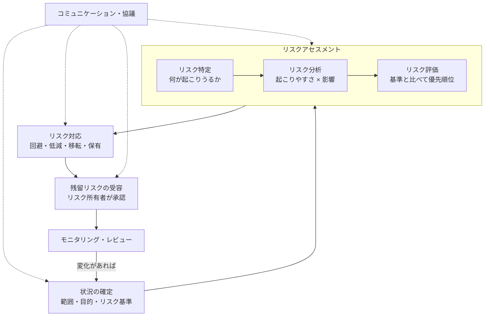
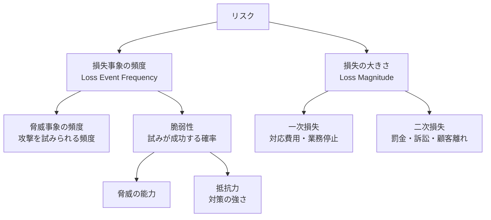
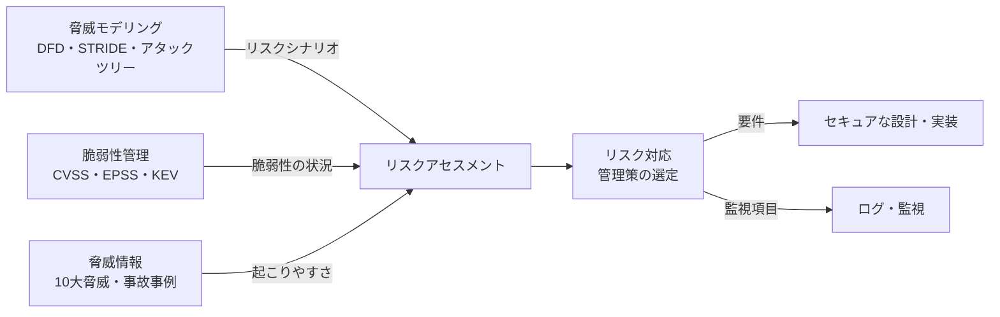

# リスク管理とリスクアセスメント

## はじめに

セキュリティ対策は **「100%安全」を目指すものではありません**。お金も人も時間も限られている中で、

> **「どのリスクに、どれだけ、どの順番で手を打つか」を決めて、決めたとおりに管理し続けること**

これが **リスク管理（リスクマネジメント）** です。そのうち「リスクを洗い出し、大きさを見積もり、対応が必要か判断する」部分を **リスクアセスメント** と呼びます。

脅威・脆弱性・リスクの違いとリスク対応の4分類は [[01_CIA三原則・脅威・脆弱性・リスク（基礎講座第1回）]] で扱いました。本ノートはその先の、**規格に沿った手順・リスク値の出し方・記録の付け方・実務での回し方** をまとめます。

### 一言でいうと

> 「**守るものを決め、起こりうる悪いことを見積もり、手を打つか打たないかを根拠つきで決める**」

---

## 1. 用語の整理

| 用語 | 意味 | 例 |
|---|---|---|
| **リスク（Risk）** | 目的に対する不確かさの影響（JIS Q 31000 / JIS Q 27000）。情報セキュリティでは「脅威が脆弱性を突いて資産に損害を与える可能性 × その影響」と考えることが多い | 「会員DBが漏洩し、通知・補償・信用失墜で損失が出る可能性」 |
| **情報資産（Asset）** | 守る対象。データだけでなく、システム・サービス・人・評判も含む | 顧客情報、ソースコード、決済API、運用担当者 |
| **脅威（Threat）** | 損害を起こしうる原因 | 外部攻撃者、内部不正、地震、操作ミス |
| **脆弱性（Vulnerability）** | 脅威に付け入られる弱点 | 未パッチの VPN 装置、弱いパスワード、バックアップなし |
| **リスク所有者（Risk Owner）** | そのリスクを管理する責任と権限を持つ人 | 会員サービスの事業責任者 |
| **リスク基準（Risk Criteria）** | 「どの大きさなら許容するか」の物差し | 「リスク値3は必ず対応、2は計画対応、1は受容可」 |
| **リスク選好（Risk Appetite）** | 目的達成のために取りにいく／受け入れるリスクの量（経営の方針） | 「新規事業ではある程度のリスクを取る」 |
| **リスク許容度（Risk Tolerance）** | リスク選好を測れる形にしたもの | 「個人情報の漏洩は年1%未満の確率に抑える」 |
| **固有リスク（Inherent Risk）** | 対策を考慮する前のリスク | 何も対策していない状態での漏洩リスク |
| **残留リスク（Residual Risk）** | 対策を講じた後に残るリスク | MFA 導入後も残る、端末マルウェア経由の乗っ取りリスク |

> **ポイント**: リスクは「脅威」単体でも「脆弱性」単体でもなく、**資産 × 脅威 × 脆弱性 の組み合わせ** で生まれる。どれか1つがゼロならリスクもほぼゼロになる。

---

## 2. リスクマネジメントの全体像

リスクマネジメントの共通の枠組みは **ISO 31000**（あらゆる分野のリスク管理）で、情報セキュリティ向けに具体化したのが **ISO/IEC 27005**（最新は 2022年版・第4版）です。ISMS 認証規格 **ISO/IEC 27001**（JIS Q 27001）は「6.1.2 リスクアセスメント」「6.1.3 リスク対応」でこのプロセスの実施を要求しています。



| 段階 | やること | 成果物 |
|---|---|---|
| 状況の確定 | 対象範囲、事業の目的、法規制、リスク基準を決める | 適用範囲、リスク基準 |
| リスク特定 | 資産・脅威・脆弱性・シナリオを洗い出す | 情報資産台帳、リスク一覧 |
| リスク分析 | 起こりやすさと影響を見積もり、リスクの大きさを決める | リスク値 |
| リスク評価 | リスク基準と比べ、対応の要否と優先順位を決める | 優先順位つきリスク一覧 |
| リスク対応 | 対応方針と管理策を選び、計画にする | リスク対応計画、適用宣言書（SoA） |
| 受容 | 残留リスクをリスク所有者が承認する | 承認記録 |
| モニタリング | 定期的・変化時に見直す | 見直し記録 |

これらをまとめた台帳が **リスク登録簿（Risk Register）** です（→ 9章）。

---

## 3. ステップ1：状況の確定とリスク基準

アセスメントを始める前に「物差し」を決めます。ここが曖昧だと、担当者ごとに評価がばらつき、結果を比べられません。

- **範囲**: 全社か、特定サービスか、特定システムか
- **目的・制約**: 事業目標、法規制（個人情報保護法、PCI DSS など）、契約上の義務
- **リスク基準**:
  - 影響の基準（金額・件数・停止時間・法的責任などで段階を定義）
  - 起こりやすさの基準（頻度や確率で段階を定義）
  - **受容基準**（どのリスク値まで受け入れるか）
- **体制**: リスク所有者は誰か、誰が承認するか

> ISO/IEC 27001 は「**一貫性があり、妥当で、比較可能な結果**」が出るようにリスクアセスメントの基準を定めることを求めている。同じ手順を繰り返したら同じような結論になること、が目安。

---

## 4. ステップ2：リスク特定

### 4.1 2つのアプローチ（ISO/IEC 27005:2022）

2022年版では、リスクの洗い出し方として次の2つが明記されました。併用してよいとされています。

| アプローチ | 考え方 | 向いている場面 |
|---|---|---|
| **資産ベース（Asset-based）** | 資産を列挙し、それぞれに対する脅威と脆弱性を洗い出す | 抜け漏れなく網羅したい、台帳を整備したい |
| **イベントベース（Event-based）** | 「起こってほしくない事象（リスクシナリオ）」から考える。資産の細部まで分解しない | 経営層と話す、全体像を素早くつかむ、戦略レベルの検討 |

- **資産ベースの例**: 「会員DB」→ 脅威「外部攻撃」「内部不正」「障害」→ 脆弱性「アプリのSQLi」「DB管理者権限の共有」「バックアップ未検証」
- **イベントベースの例**: 「ランサムウェアで業務が1週間止まる」「委託先経由で会員情報が漏洩する」

イベントベースのシナリオは、そのまま [[04_アタックツリー]] の根（ゴール）にできます。システム単位で細かく見るなら [[05_データフロー図]] + [[02_STRIDE]] が資産ベースの特定にあたります（→ 8章）。

### 4.2 情報資産台帳を作る

資産ベースで進めるなら、まず **情報資産台帳** を作り、資産ごとに CIA の重要度を付けます。

| 資産 | 保管場所 | 管理者 | 機密性 | 完全性 | 可用性 | 重要度 |
|---|---|---|---|---|---|---|
| 会員情報（氏名・住所・メール） | RDS（本番） | 会員サービス部 | 3 | 3 | 2 | 3 |
| 決済トークン | 決済代行事業者 | 決済チーム | 3 | 3 | 3 | 3 |
| 社内Wiki | SaaS | 情シス | 2 | 1 | 1 | 2 |
| 公開Webサイトの静的ページ | CDN | 広報 | 1 | 2 | 2 | 2 |

- 重要度は「CIA のうち最大値」とするのがよくあるやり方（IPA ガイドラインも同様の考え方）
- データの「所在」と「流れ」も書いておくと、後でデータフロー図や漏洩時の影響範囲の特定に使える
- 個人情報は **持たないこと自体が最強の対策**（[[05_データ最小化]]）。台帳作りは「この資産は本当に要るか」を見直す機会でもある

### 4.3 脅威と脆弱性の情報源

- IPA「情報セキュリティ10大脅威」（毎年1月頃公表）
- 同業他社の事故事例、自社の過去インシデント（[[10_2026年_国内情報漏洩の動向と対策]]）
- 脆弱性情報: JVN、NVD、CISA KEV（[[03_セキュリティの基本概念と専門用語（知識地図3章）]]）
- 脅威モデリングの成果物（[[01_脅威モデリングの基礎]]）
- 脆弱性診断・ペネトレーションテストの結果

---

## 5. ステップ3：リスク分析

### 5.1 3つの分析方法

| 方法 | 内容 | 長所 | 短所 |
|---|---|---|---|
| **定性的** | 「高・中・低」などの段階で評価 | 速い、データがなくてもできる、合意しやすい | 主観が入る、リスク同士の細かい比較が難しい |
| **半定量的** | 段階に数値（1〜3、1〜5、0〜100など）を割り当てて掛け合わせる | 優先順位を付けやすい | 数値に見えても中身は主観。足し算・掛け算の意味に注意 |
| **定量的** | 金額・確率で評価（ALE、FAIR など） | 投資判断（費用対効果）に直結する | データ収集が大変。見積もりの幅が大きい |

実務では **まず定性／半定量で全体を俯瞰し、重要なリスクだけ定量化する** のが一般的です。

### 5.2 IPA 方式（中小企業の情報セキュリティ対策ガイドライン）

IPA のガイドライン（第3.1版）は、付録の「リスク分析シート」で次の2段階のマトリクスを使います。

**① 被害発生可能性 = 脅威 × 脆弱性**

| 脅威 ＼ 脆弱性 | 低（必要な対策をすべて実施） | 中（一部実施） | 高（対策なし） |
|---|---|---|---|
| **高**（通常の状況でいつでも起こりうる） | 中 | 高 | 高 |
| **中**（特定の状況で起こりうる・年に数回程度） | 低 | 中 | 高 |
| **低**（通常の状況では起こらない） | 低 | 低 | 中 |

**② リスク値 = 被害発生可能性 × 重要度**

| 被害発生可能性 ＼ 重要度 | 低（事業への影響が少ない） | 中（事業に深刻な影響） | 高（法的責任・事業や顧客に重大な影響） |
|---|---|---|---|
| **高** | 2 | 3 | 3 |
| **中** | 1 | 2 | 3 |
| **低** | 1 | 1 | 2 |

| リスク値 | 意味 | 対応の目安 |
|---|---|---|
| **3** | 重大な事故が起こる可能性が高い | 優先して対策 |
| **2** | 重大な事故が起こる可能性がある | 計画的に対策 |
| **1** | 事故の可能性は低く、被害も許容範囲 | 受容してよい |

> この方式のよいところは「**脆弱性 = 対策状況**」と定義しているため、対策を実施すると脆弱性が下がり、リスク値が下がる様子が目に見えること。

### 5.3 NIST SP 800-30 Rev.1 の考え方

米国 NIST の **SP 800-30 Rev.1（Guide for Conducting Risk Assessments, 2012）** は、リスクアセスメントを4ステップで定めています。

1. **準備（Prepare）**: 目的・範囲・前提・情報源・使うモデルを決める
2. **実施（Conduct）**:
   - 脅威源（攻撃者・事故・自然災害など）と脅威事象を特定
   - 脆弱性と「前提条件（predisposing conditions：例 単一のデータセンターに依存）」を特定
   - **起こりやすさ（Likelihood）** を決める: 脅威事象が発生する可能性 × 発生したときに悪影響が出る可能性
   - **影響（Impact）** を決める
   - **リスク = 起こりやすさ × 影響** を決める
3. **伝達（Communicate）**: 意思決定者に結果を伝える
4. **維持（Maintain）**: 継続的に見直す

評価は「Very Low / Low / Moderate / High / Very High」の5段階（または 0〜100 の半定量スケール）で、付録に評価表が用意されています。攻撃者については **能力・意図・標的** の3点で評価するのが特徴です。

> 「発生確率は高いが影響は小さい」事象と「発生確率は低いが影響は大きい」事象が、同じリスクの大きさになりうる。後者（低頻度・高影響）は見落とされやすいので、**影響だけで別途しきい値を設ける**（例：影響が「非常に高」なら確率に関係なく検討対象）こともある。

### 5.4 定量的分析：ALE（年間予想損失額）

古典的な定量分析の式です（情報処理技術者試験や CISSP でも頻出）。

```
SLE（単一損失予想額）  = AV（資産価値） × EF（暴露係数：1回で失う割合 0〜100%）
ALE（年間予想損失額）  = SLE × ARO（年間発生率）
```

**計算例：会員DBの漏洩**

| 項目 | 値 | 根拠の例 |
|---|---|---|
| AV | 5,000万円 | 対応費用・補償・売上減少・システム改修の見積もり |
| EF | 40% | 全件ではなく一部が漏れる想定 |
| SLE | 2,000万円 | 5,000万 × 0.4 |
| ARO | 0.1（10年に1回） | 業界の事故頻度、自社の状況 |
| **ALE** | **200万円/年** | 2,000万 × 0.1 |

**対策の費用対効果**: WAF・DBの監視・権限分離を入れて ARO が 0.02 に下がるなら、

```
対策後の ALE = 2,000万 × 0.02 = 40万円/年
年間の削減効果 = 200万 − 40万 = 160万円
対策の年間コスト = 60万円  →  160万 − 60万 = +100万円（実施する価値あり）
```

> 注意: AV・EF・ARO はどれも推定値。**1点の数字ではなく「最小〜最大」の幅で見積もる** ほうが実態に合う。

### 5.5 FAIR（Factor Analysis of Information Risk）

ALE を発展させた、サイバーリスクを金額で表すための標準モデルです（The Open Group が標準化、FAIR Institute が普及）。



- 各要素を **最小値・最頻値・最大値** で見積もり、モンテカルロシミュレーションで「年間損失額の分布」を出す
- 「90%の確率で年間損失は X 円以下」のように、経営層が理解しやすい形で示せる
- サイバー保険の加入額や、セキュリティ投資の優先順位付けに使われる

---

## 6. ステップ4：リスク評価

分析で出したリスクの大きさを **リスク基準と比べ、対応の要否と優先順位を決めます**。

- リスク値が受容基準を超える → 対応が必要
- 同じリスク値なら、**影響が大きいもの・法的責任を伴うもの・顧客に被害が及ぶもの** を優先
- 対策の **コストと効果**、実施に要する **期間** も考慮する
- 結果はリスク所有者（事業側の責任者）と合意する。セキュリティ担当者だけで決めない

### ヒートマップで可視化する

```
影響 ↑
 高 │  中   高   高
 中 │  低   中   高
 低 │  低   低   中
    └──────────────→ 起こりやすさ
       低   中   高
```

右上ほど優先度が高い。リスク一覧を点で打っておくと、対策後に点が左下へ動く様子を報告に使える。

---

## 7. リスク対応

### 7.1 4つの基本方針

| 方針 | 意味 | 例 |
|---|---|---|
| **回避（Avoid）** | リスクの原因となる活動をやめる・変える | クレジットカード番号を自社で保持しない（決済代行に任せる）、不要な公開サービスを停止 |
| **低減（Mitigate / Modify）** | 起こりやすさや影響を小さくする | MFA、パッチ適用、暗号化、バックアップ、監視 |
| **移転・共有（Transfer / Share）** | 損失の一部を他者と分け合う | サイバー保険、外部委託（契約で責任分担）、クラウドの責任共有 |
| **保有・受容（Retain / Accept）** | 根拠をもってそのまま受け入れる | 影響が小さく対策が高すぎるリスク |

> **移転しても「責任」は移らない**。委託先で漏洩しても、委託元は個人情報保護法上の監督責任を問われる（[[09_サプライチェーン攻撃と委託先管理]]）。保険も「お金」は補えるが「信用」は戻らない。

> **受容は「放置」ではない**。誰が・いつ・どんな根拠で受け入れたかを記録し、定期的に見直すことが条件。

### 7.2 ISO 31000 の7つの選択肢

ISO 31000:2018 は、上の4分類をさらに細かく分けています。

1. リスクを生じさせる活動を **始めない・やめる**（回避）
2. 機会を追求するために **リスクを取る・増やす**
3. **リスク源を取り除く**
4. **起こりやすさを変える**
5. **結果（影響）を変える**
6. **リスクを共有する**（契約、保険など）
7. 情報に基づいた意思決定で **リスクを保有する**

2 があるのが特徴で、リスクには「損失」だけでなく「機会」の側面もある、という ISO 31000 の考え方を表しています。

### 7.3 管理策の選び方とリスク対応計画

ISMS では、リスク対応に必要な管理策を決めたあと、**ISO/IEC 27001 附属書A** の管理策（2022年版で93個、4分類）と照らし合わせて抜け漏れを確認します。

| 分類（27001:2022 附属書A） | 管理策の数 | 例 |
|---|---|---|
| 組織的管理策 | 37 | 情報セキュリティ方針、供給者関係、インシデント管理、脅威インテリジェンス |
| 人的管理策 | 8 | 教育訓練、秘密保持契約、リモートワーク |
| 物理的管理策 | 14 | 入退室管理、クリアデスク、機器の廃棄 |
| 技術的管理策 | 34 | アクセス制御、マルウェア対策、ログ取得、セキュアコーディング、データマスキング |

- **適用宣言書（SoA: Statement of Applicability）**: 93の管理策それぞれについて「採用するか」「採用・除外の理由」「実施状況」を書いた文書
- **リスク対応計画**: どのリスクに、どの管理策を、誰が、いつまでに実施するか
- 対策後は **残留リスク** を再評価し、リスク所有者が受容を承認する

対策を選ぶときは、1つの対策に頼らず層を重ねる（[[02_深層防御]]）、権限を絞って影響を小さくする（[[01_最小権限の原則]]）、といった設計原則が効きます。

---

## 8. リスクアセスメントの4つのアプローチ（進め方の戦略）

組織全体をどの細かさで見るかの選択肢です。日本の情報処理技術者試験でもよく問われます。

| アプローチ | 内容 | 長所 | 短所 |
|---|---|---|---|
| **ベースラインアプローチ** | 既存の基準・ガイドライン（ISO 27002、CIS Controls、業界ガイドライン）に沿って、必要な対策ができているかをチェックする | 速い、低コスト | 組織固有のリスクを見落とす。基準が合わないと過不足が出る |
| **非形式的アプローチ** | 担当者・専門家の経験や知見で判断する | 小さい工数ですぐできる | 属人的。根拠を説明しにくい |
| **詳細リスク分析** | 資産ごとに脅威・脆弱性・影響を詳しく分析する | 精度が高く、根拠が明確 | 時間とコストがかかる |
| **組み合わせアプローチ** | 重要な資産は詳細リスク分析、それ以外はベースラインで、と使い分ける | 効率と精度のバランスがよい | 振り分けの判断が必要 |

> 現実的には **組み合わせアプローチ** が主流。まずベースライン（例：IPA の「5分でできる！情報セキュリティ自社診断」や CIS Controls）で底上げし、重要度3の資産だけ詳細に分析する。

---

## 9. リスク登録簿（Risk Register）

リスク管理の中心となる台帳です。スプレッドシートでも、チケット管理ツールでも構いません。

| ID | リスクシナリオ | 資産 | 脅威 | 脆弱性 | 可能性 | 影響 | リスク値 | 方針 | 対策 | 所有者 | 期限 | 残留 | 見直し日 |
|---|---|---|---|---|---|---|---|---|---|---|---|---|---|
| R-01 | VPN 装置の脆弱性を突かれ社内に侵入、ランサムウェアで業務停止 | 社内ネットワーク全体 | ランサムウェア攻撃者 | VPN の未パッチ、MFA なし | 高 | 高 | 3 | 低減 | パッチの即時適用手順、MFA、オフラインバックアップ | 情シス部長 | 2026-12 | 2 | 2027-03 |
| R-02 | 会員DBへの SQLi で個人情報漏洩 | 会員情報 | 外部攻撃者 | 一部の旧APIで文字列連結のSQL | 中 | 高 | 3 | 低減 | プレースホルダ化、WAF、取得件数の上限と監視 | 会員サービス責任者 | 2026-11 | 1 | 2027-04 |
| R-03 | 委託先の保守アカウント経由で侵入 | 本番環境 | 委託先を踏み台にした攻撃者 | 常時有効な保守アカウント | 中 | 高 | 3 | 低減＋移転 | JIT アクセス、契約に報告義務・監査条項 | 開発部長 | 2027-01 | 2 | 2027-04 |
| R-04 | カード番号の漏洩 | カード情報 | 外部攻撃者 | — | — | 高 | — | 回避 | 自社で保持しない（決済代行のトークン化） | CTO | 済 | — | 年1回 |
| R-05 | 社内Wiki の一時的な閲覧不能 | 社内Wiki | SaaS 障害 | 単一 SaaS 依存 | 中 | 低 | 1 | 受容 | なし（SaaS の SLA で許容） | 情シス | — | 1 | 年1回 |

R-01・R-03 の型は [[08_ランサムウェア対策]]、[[07_脆弱性管理（境界機器・パッチ運用）]] で詳しく扱っています。

---

## 10. 脅威モデリング・脆弱性管理との関係

リスク管理は「組織全体の意思決定の枠組み」、脅威モデリングや脆弱性管理は「その入力を作る技術的な活動」という関係です。



| 活動 | リスク管理の中での役割 | 関連ノート |
|---|---|---|
| 脅威モデリング | システム単位でのリスク特定 | [[01_脅威モデリングの基礎]]、[[02_STRIDE]] |
| DREAD など | システム単位でのリスク分析（簡易スコア） | [[03_DREAD]] |
| 脆弱性管理 | 脆弱性の発見と、対応の優先順位付け | [[07_脆弱性管理（境界機器・パッチ運用）]] |
| 監視・ログ | 残留リスクのモニタリング、検知 | [[A09_ログとモニタリングの不備]] |

### CVSS はリスクではない

よくある誤解です。**CVSS は脆弱性の「深刻度」** であり、自社にとっての「リスク」ではありません。

- CVSS 9.8 でも、その製品を使っていない・外部から到達できないなら自社のリスクは低い
- CVSS 6.5 でも、インターネットに公開された VPN 装置で **実際に悪用されている（KEV 掲載）** なら最優先

脆弱性対応の優先順位は「**深刻度（CVSS）× 悪用の可能性（EPSS・KEV）× 資産の重要度・露出度**」で決めます。これはまさにリスク分析の考え方そのものです。

---

## 11. フレームワークでの位置づけ

| フレームワーク | リスク管理の扱い |
|---|---|
| **ISO 31000:2018** | 分野を問わないリスクマネジメントの原則と枠組み |
| **ISO/IEC 27001:2022**（JIS Q 27001:2023） | ISMS の要求事項。6.1.2 リスクアセスメント、6.1.3 リスク対応、8.2/8.3 で実施を要求 |
| **ISO/IEC 27005:2022** | 情報セキュリティリスク管理の手引き。資産ベース／イベントベース、リスクシナリオ |
| **NIST SP 800-30 Rev.1** | リスクアセスメントの実施方法（米国連邦政府向けだが広く参照） |
| **NIST SP 800-37 Rev.2（RMF）** | システムのライフサイクル全体のリスク管理フレームワーク |
| **NIST CSF 2.0**（2024年2月） | 新設の **GOVERN（統治）** 機能に「リスク管理戦略（GV.RM）」を置き、リスク選好・許容度の表明（GV.RM-02）などを経営の責任として明確化 |
| **経産省・IPA サイバーセキュリティ経営ガイドライン Ver3.0** | 経営者がリスクを認識し、対策を指示する責任を明記 |
| **IPA 中小企業の情報セキュリティ対策ガイドライン 第3.1版** | 中小企業向けのリスク分析シート（本ノート 5.2） |

> NIST CSF 2.0 で GOVERN が加わった意味は大きい。「セキュリティは技術部門の仕事」ではなく、**リスクをどこまで受け入れるかは経営が決めること** だと明確にした。

---

## 12. 継続的に回す

リスクは変わります。一度アセスメントして終わりではありません。

### 見直しのタイミング

- **定期**: 年1回以上（ISMS では内部監査・マネジメントレビューと連動）
- **変化時**:
  - 新サービス・新機能のリリース、システム構成の大きな変更
  - クラウド移行、新しい SaaS や委託先の採用
  - 組織変更、M&A
  - 重大な脆弱性の公表（例：使っている境界機器に KEV 掲載）
  - 自社や同業他社でのインシデント
  - 法改正（例：個人情報保護法の改正）

### 開発チームでの取り入れ方

- 設計レビューのテンプレートに「新しく扱う資産」「想定するリスクシナリオ」の欄を入れる
- 大きな機能追加のときは軽量な脅威モデリングを行い、結果をリスク登録簿に追記する
- 受容したリスクはチケット化し、見直し期限を設定する
- インシデントの振り返り（ポストモーテム）で、リスク登録簿の評価が妥当だったかを確認する（[[01_インシデント対応の基本フロー]]）

---

## 13. よくある失敗

| 失敗 | 何が問題か | 改善 |
|---|---|---|
| 台帳作りが目的になる | 作って満足し、対策も見直しもされない | 対応計画と期限まで書き、進捗を追う |
| すべてを「高」にする | 優先順位が付かず、何も進まない | 基準を具体的（件数・金額・時間）に定義する |
| セキュリティ担当者だけで評価する | 事業への影響が過小／過大評価される | 事業側のリスク所有者を必ず巻き込む |
| 受容の記録がない | 事故のとき「誰が決めたのか」が分からない | 受容者・日付・根拠・見直し日を記録 |
| 数値を過信する | 推定値の掛け算に過ぎないのに精密に見える | 幅で見積もる、前提を書いておく |
| 低頻度・高影響を軽視する | ランサムウェアや大規模漏洩を「めったにない」で済ませる | 影響単独のしきい値を設ける、BCP と連動させる |
| 委託先・クラウドを範囲外にする | 侵入口の多くが委託先・境界機器 | 範囲に含め、委託先の評価も行う |

---

## 14. チェックリスト

- [ ] リスク管理の範囲と、リスク所有者が決まっているか？
- [ ] リスク基準（影響・起こりやすさ・受容基準）が文書化されているか？
- [ ] 情報資産台帳があり、重要度が付いているか？
- [ ] 主要なリスクシナリオ（ランサムウェア、漏洩、委託先経由、内部不正、障害）が登録簿にあるか？
- [ ] 各リスクに対応方針・対策・担当・期限があるか？
- [ ] 残留リスクの受容が承認・記録されているか？
- [ ] 年1回以上、および大きな変化のときに見直しているか？
- [ ] 脆弱性の優先順位付けに、資産の重要度と悪用状況を加味しているか？
- [ ] 経営層にリスクの状況が報告されているか？

---

## まとめ

- リスク管理は **「どのリスクに、どれだけ、どの順番で手を打つか」を根拠つきで決め続けること**
- 流れは **状況の確定 → 特定 → 分析 → 評価 → 対応 → 受容 → モニタリング**（ISO 31000 / ISO/IEC 27005）
- リスクの特定は **資産ベース** と **イベントベース** を使い分ける
- 分析は **定性 → 必要に応じて定量（ALE・FAIR）**。IPA 方式は「脅威 × 脆弱性 → 被害発生可能性 × 重要度」
- 対応は **回避・低減・移転・保有**。移転しても責任は残り、受容は記録と見直しが条件
- **CVSS は深刻度でありリスクではない**。資産の重要度と悪用状況を掛け合わせる
- **リスク登録簿** を中心に、定期と変化時に見直す。リスクをどこまで受け入れるかは **経営が決める**（NIST CSF 2.0 GOVERN）

---

## 関連ノート

- [[01_CIA三原則・脅威・脆弱性・リスク（基礎講座第1回）]] — 脅威・脆弱性・リスクの違い、対応の4分類
- [[03_セキュリティの基本概念と専門用語（知識地図3章）]] — CVSS・EPSS・KEV・SSVC
- [[01_脅威モデリングの基礎]] / [[03_DREAD]] / [[04_アタックツリー]]
- [[04_セキュアバイデザイン]] — 設計段階でリスクを減らす
- [[07_脆弱性管理（境界機器・パッチ運用）]] / [[08_ランサムウェア対策]] / [[09_サプライチェーン攻撃と委託先管理]]

## 参考

- ISO/IEC 27005:2022 Information security, cybersecurity and privacy protection — Guidance on managing information security risks: https://www.iso.org/standard/80585.html
- NIST SP 800-30 Rev.1 Guide for Conducting Risk Assessments: https://csrc.nist.gov/pubs/sp/800/30/r1/final
- NIST Cybersecurity Framework 2.0: https://www.nist.gov/cyberframework
- IPA 中小企業の情報セキュリティ対策ガイドライン: https://www.ipa.go.jp/security/guide/sme/about.html
- IPA サイバーセキュリティ対策の実践事例（リスク値の算定）: https://www.ipa.go.jp/security/economics/practices_navi/practice211.html
- FAIR Institute: https://www.fairinstitute.org/
