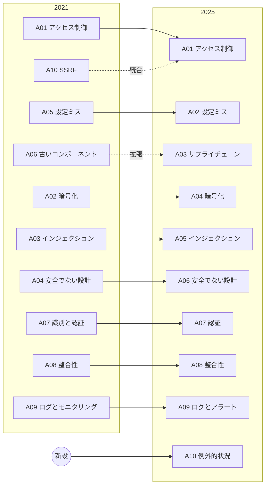

# OWASP Top 10:2025 の変更点（2021 → 2025）

## はじめに

OWASP Top 10 は 2021年版のあと、4年ぶりに **2025年版** が出ました。2025年11月6日に OWASP Global AppSec（ワシントンD.C.）でリリース候補（RC）が公開され、意見募集を経て正式版になっています。

このフォルダの A01〜A10 の個別ノートは **2021年版の番号** で書いています。内容の大部分は 2025年版でもそのまま通用するので、本ノートで **「2025年版のどの項目が、どのノートに対応するか」** を整理し、新設された2項目は個別ノートを追加しました。

- 全体の入口: [[00_OWASP概要]]
- 新設: [[2025_A03_ソフトウェアサプライチェーンの不備]]、[[2025_A10_例外的状況の不適切な処理]]

---

## 2025年版の一覧と 2021年版との対応

| 2025 | 名称（英語） | 名称（日本語） | 2021年版から | 読むノート |
|---|---|---|---|---|
| **A01** | Broken Access Control | アクセス制御の不備 | 1位のまま。**SSRF（旧A10）を統合** | [[A01_アクセス制御の不備]]、[[A10_サーバーサイドリクエストフォージェリ]] |
| **A02** | Security Misconfiguration | セキュリティの設定ミス | 5位 → **2位** | [[A05_セキュリティの設定ミス]] |
| **A03** | Software Supply Chain Failures | ソフトウェアサプライチェーンの不備 | **新設**（旧A06「脆弱で古いコンポーネント」を拡張） | [[2025_A03_ソフトウェアサプライチェーンの不備]]、[[A06_脆弱で古いコンポーネント]] |
| **A04** | Cryptographic Failures | 暗号化の不備 | 2位 → 4位 | [[A02_暗号化の不備]] |
| **A05** | Injection | インジェクション | 3位 → 5位 | [[A03_インジェクション]] |
| **A06** | Insecure Design | 安全でない設計 | 4位 → 6位 | [[A04_安全でない設計]] |
| **A07** | Authentication Failures | 認証の失敗 | 7位のまま。「Identification and」が取れて改名 | [[A07_認証と識別の失敗]] |
| **A08** | Software or Data Integrity Failures | ソフトウェアまたはデータの整合性の不備 | 8位のまま | [[A08_ソフトウェアとデータの整合性の不備]] |
| **A09** | Security Logging & Alerting Failures | セキュリティログとアラートの不備 | 9位のまま。「Monitoring」→「**Alerting**」に改名 | [[A09_ログとモニタリングの不備]] |
| **A10** | Mishandling of Exceptional Conditions | 例外的状況の不適切な処理 | **新設** | [[2025_A10_例外的状況の不適切な処理]] |

---

## 主な変更点

### 1. SSRF がアクセス制御の不備に統合された

SSRF は「サーバーに、本来アクセスしてはいけない宛先へリクエストさせる」問題です。つまり **サーバーという主体に対するアクセス制御の失敗** と整理され、A01 に入りました。攻撃手法と対策そのものは変わらないので、[[A10_サーバーサイドリクエストフォージェリ]] はそのまま使えます。

### 2. 設定ミスが2位に上昇

クラウド・コンテナ・IaC の普及で、**コードより設定で振る舞いが決まる部分** が増えたことを反映しています。テストされたアプリの 3.00% に該当 CWE が見つかりました。

### 3. サプライチェーンが独立カテゴリに（A03）

コミュニティ調査で **回答者のちょうど50%が1位に選んだ** 項目です。2021年版の「既知の脆弱性を持つコンポーネント」から、**ビルド・配布・更新の仕組み全体**（CI/CD、開発者の端末、IDE拡張、パッケージレジストリ）の侵害まで範囲が広がりました。2025年の npm ワーム「Shai-Hulud」などが背景にあります。

### 4. 例外的状況の扱いが新設（A10）

エラー処理の不備、ロジックエラー、**フェイルオープン**（失敗したときに通してしまう）など、異常系の扱いに関する 24 の CWE をまとめた新カテゴリです。これまで「コード品質が悪い」と一括りにされていたものに、具体的な指針を与える目的があります。

### 5. 「根本原因」寄りの分類へ

OWASP は 2021年版から、「症状（攻撃名）」ではなく **「根本原因」** でカテゴリを作る方針をとっています。2025年版でもその流れで、たとえば A07 は「識別」を外して認証そのものの失敗に焦点を絞りました。

### 6. 名称の変更

- A07: Identification and Authentication Failures → **Authentication Failures**
- A09: Security Logging and Monitoring Failures → Security Logging and **Alerting** Failures
  - 「記録して眺める」だけでなく、**アラートを出して人が動けること** が重要、というメッセージ

---

## データと選定方法

| 項目 | 内容 |
|---|---|
| 提供データ | 13の組織・個人から、**280万件以上のアプリケーション** のテスト結果 |
| 分析した CWE | 589種類（MITRE の CWE 辞書は全968種類） |
| Top 10 に含まれる CWE | 合計 248。1カテゴリあたり 5〜40、平均約25 |
| CVE との対応 | NVD の約22万件の CVE のうち、約17.5万件を CWE にマッピング |
| 選定方法 | データから8カテゴリ、**コミュニティ調査から2カテゴリ**（A03・A09） |

> コミュニティ調査枠があるのは、テストデータ（ツールで見つけやすいもの）だけでは、**現場の実務者が本当に困っているリスク** を拾いきれないため。サプライチェーンやログの不備は、自動テストで発見しにくい代表例です。

### カテゴリごとの CWE 数（主なもの）

| カテゴリ | CWE 数 |
|---|---|
| A01 アクセス制御の不備 | 40 |
| A05 インジェクション | 38 |
| A07 認証の失敗 | 36 |
| A04 暗号化の不備 | 32 |
| A10 例外的状況の不適切な処理 | 24 |
| A02 設定ミス | 16 |
| A03 サプライチェーン / A09 ログとアラート | 各5（A03 の詳細ページでは6） |

---

## 2021年版のノートを読むときの注意

- 番号は 2021年版のまま。**2025年版の番号で話すときは上の対応表で読み替える**
- 内容（攻撃の仕組み・対策）はほぼそのまま有効
- 2025年版で強調が増えたポイント
  - [[A06_脆弱で古いコンポーネント]] → CI/CD・開発者端末・ビルド成果物の保護まで含めて考える（[[2025_A03_ソフトウェアサプライチェーンの不備]]）
  - [[A09_ログとモニタリングの不備]] → 「アラートを出して対応につなげる」まで
  - [[A05_セキュリティの設定ミス]] → 2位に上がった。クラウド設定・IaC のレビューを優先
- 新しい観点として、エラー処理・フェイルクローズを [[2025_A10_例外的状況の不適切な処理]] で補う

---

## まとめ

- 2025年版は **2項目が新設**（A03 サプライチェーン、A10 例外的状況）、**SSRF は A01 に統合**
- **設定ミスが2位** に上昇し、暗号化・インジェクション・安全でない設計はそれぞれ2つずつ順位を下げた
- データ（280万件超のアプリ）＋コミュニティ調査（2枠）で選定
- 既存の A01〜A10 ノート（2021年版）は内容として有効。番号の読み替えだけ注意

## 参考

- OWASP Top 10:2025: https://top10.owasp.org/2025/
- Introduction（変更点）: https://top10.owasp.org/2025/0x00_2025-Introduction/
- OWASP Top 10:2025 日本語版: https://owasp.org/Top10/2025/ja/
