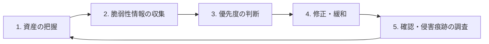

# 脆弱性管理（境界機器・パッチ運用）

## はじめに

**脆弱性管理**とは、自分たちが持っている IT 資産の脆弱性を見つけ、優先度をつけ、期限内に直し続ける運用のことです。ライブラリの話は [[A06_脆弱で古いコンポーネント]] で扱い、このノートでは **VPN・ファイアウォール・ファイル転送製品などの境界機器** と、組織としての運用を中心にまとめます。

### なぜ今重要か

- 2026年上半期の国内ランサムウェア被害では、経路が分かったもののうち **VPN 機器が約5割、RDP が 4分の1**（警察庁）
- 世界の漏洩でも、入口は **脆弱性の悪用（31%）** が盗まれた認証情報を初めて上回った（Verizon DBIR 2026）
- 脆弱性が公表されてから悪用されるまでの期間が短くなり、悪用ツールも自動化されている

---

## 脆弱性管理のサイクル

### 1. 資産の把握

**持っていることを知らない機器は直せません**。

- 機器・OS・ミドルウェア・SaaS の一覧（CMDB）を作り、**バージョンとサポート期限** も記録する
- **ASM**（Attack Surface Management）で、インターネットから見えている資産を外から定期的にスキャンする。忘れられた検証用サーバーや古い VPN が見つかる
- ソフトウェアは **SBOM** で中身を把握する

### 2. 脆弱性情報の収集

| 情報源 | 内容 |
|---|---|
| ベンダーのセキュリティアドバイザリ | 使っている製品の公式情報。メール通知を登録する |
| JVN / JPCERT/CC 注意喚起 | 国内向けの脆弱性情報と、悪用が確認されたものの注意喚起 |
| **CISA KEV**（Known Exploited Vulnerabilities） | **実際に悪用が確認された** 脆弱性の一覧。優先度の判断で最も役に立つ |
| EPSS | 今後 30 日に悪用される確率の予測値 |

### 3. 優先度の判断

CVSS の点数だけで決めると、対応すべきものが多すぎて回りません。**「悪用されているか」「外から届くか」** を重く見ます。

| 条件 | 対応期限の例 |
|---|---|
| KEV 掲載・または注意喚起あり、かつインターネットに公開された機器 | **48〜72 時間以内** |
| CVSS 9.0 以上で外部公開 | 7日以内 |
| CVSS 7.0 以上 | 30日以内 |
| それ以外 | 通常の定期メンテナンスで |

期限は組織ごとに決め、**SLA として守れているかを測ります**。

### 4. 修正・緩和

- パッチをすぐ当てられないときは、**緩和策** をとる：管理画面を外部から見えなくする、該当機能を止める、IP 制限をかける
- **サポートが終わった製品（EOL）** はパッチが出ない。更新計画を立てて置き換える。2026年のタイムズカーの事例では、サポートが終わった Java フレームワーク Seasar2 を使っていたという指摘があった（因果関係は未確認）

### 5. 確認と侵害痕跡の調査

ここが見落とされやすいポイントです。

> [!important] パッチを当てても、すでに入られているかもしれない
> 脆弱性が公表される前から悪用されていた場合、パッチを当てても **攻撃者が作ったアカウントやバックドアは残ります**。境界機器の重大な脆弱性に対応したら、次も行う。
> - ベンダーや JPCERT/CC が公開している **IoC（侵害の痕跡）** と照らし合わせる
> - 機器に保存されていた **認証情報（VPN アカウント、LDAP 連携のパスワード）をリセット** する
> - 見覚えのない管理者アカウントや設定変更がないか確かめる

---

## ゼロデイへの考え方

2026年の KDDI の事例は、ベンダーも把握していない **ゼロデイ脆弱性** が使われました（5/16 に被害が始まり、6/17 に把握）。ゼロデイはパッチ運用では防げません。

- 侵入される前提で、**届くデータを小さくする**（[[01_最小権限の原則]] / [[05_データ最小化]]）
- **異常を早く見つける**（[[A09_ログとモニタリングの不備]]）
- 境界機器を減らす：VPN をインターネットに公開しない ZTNA への移行も選択肢（[[03_ゼロトラスト]]）

---

## チェックリスト

- [ ] インターネットに公開している機器を、すべて一覧にしているか？
- [ ] 各機器のバージョンとサポート期限を把握しているか？
- [ ] ベンダーと JPCERT/CC の情報を受け取る仕組みがあるか？
- [ ] KEV に載った脆弱性の対応期限を決めているか？
- [ ] パッチ適用の SLA を測っているか？
- [ ] 重大な脆弱性に対応したあと、侵害の痕跡を調べ、認証情報をリセットしているか？
- [ ] EOL の製品の更新計画があるか？

---

## まとめ

- 2026年の最大の入口は **VPN・RDP と既知の脆弱性**
- **資産の把握 → 情報収集 → 優先度 → 修正 → 痕跡調査** のサイクルを回す
- 優先度は CVSS より **KEV（悪用実績）とインターネット公開の有無** を重視する
- パッチを当てたら終わりではなく、**すでに侵入されていないか** を確かめる

関連：[[10_2026年_国内情報漏洩の動向と対策]] / [[08_ランサムウェア対策]] ／ 目次：[[MOC_セキュリティ体系]]
