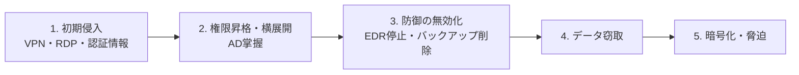

# ランサムウェア対策

## はじめに

**ランサムウェア**は、組織のデータを暗号化して使えなくし、元に戻すことと引き換えに身代金を要求する攻撃です。IPA「情報セキュリティ10大脅威」組織編で何年も 1 位が続いています。2026年上半期の国内被害は **123件** で、半期として過去最多でした（警察庁）。

### 一言でいうと

> 「**侵入 → 社内に広がる → バックアップを壊す → 暗号化と窃取 → 脅迫**」という段取りのある攻撃。どこか 1 段で止めれば被害は大きく減る。

---

## 現在のランサムウェアの特徴

| 特徴 | 内容 |
|---|---|
| **二重恐喝** | 暗号化する前にデータを盗み、「払わなければ公開する」と脅す。バックアップから戻せても漏洩は残る |
| **ノーウェアランサム** | 暗号化せず、盗んだデータの公開だけで脅す手口 |
| **RaaS**（Ransomware as a Service） | 開発者と実行役（アフィリエイト）が分業する。侵入口を売る「アクセスブローカー」もいる |
| **人が操作する攻撃** | 自動で広がるワームではなく、攻撃者が社内ネットワークを手で調べて AD やバックアップを狙う |
| **ゼロデイは不要** | 主な入口は **放置された既知の脆弱性と漏えいした認証情報**（警察庁） |

---

## 侵入経路（2026年上半期・警察庁）

経路が判明した有効回答 36 件の内訳です。

| 経路 | 件数 |
|---|---|
| VPN 機器 | 18件（約50%） |
| リモートデスクトップ（RDP） | 9件 |
| その他 | 9件 |

**VPN と RDP だけで約 4 分の 3** を占めます。メールの添付ファイルからの感染は減っています。

---

## 攻撃の流れと、各段階で止める対策

| 段階 | 攻撃者がすること | 止める対策 |
|---|---|---|
| 1. 初期侵入 | VPN の脆弱性を突く、漏れた ID でログイン、公開 RDP に総当たり | パッチ SLA（[[07_脆弱性管理（境界機器・パッチ運用）]]）、VPN に MFA、RDP をインターネットに出さない、使っていないアカウントの削除 |
| 2. 横展開 | 認証情報を盗んで AD の管理者権限を取る | 管理者アカウントの階層分離（Tier モデル）、LAPS、[[01_最小権限の原則]]、ネットワーク分割 |
| 3. 防御の無効化 | EDR を止め、バックアップや VSS を削除する | EDR の改ざん防止機能、**バックアップを別の認証基盤・別アカウントに置く** |
| 4. 窃取 | クラウドストレージなどへ大量に送る | 外向き通信の監視・制限（[[A09_ログとモニタリングの不備]]）、DLP |
| 5. 暗号化 | 一斉に暗号化して脅迫文を置く | イミュータブルなバックアップから復元（[[04_DR訓練とRTO・RPO]]） |

---

## バックアップの考え方

ランサムウェアは **バックアップも狙います**。本番と同じ AD 権限で消せるバックアップは、ないのと同じです。

- **3-2-1-1-0 ルール**：コピー 3 つ、媒体 2 種類、1 つは別の場所、**1 つはオフラインか書き換え不可**、**復元テストでエラー 0**
- **認証を分ける**：バックアップ管理は本番 AD と別のアカウントや別のクラウドアカウントで管理する
- **復元にかかる時間を測る**：全台を戻すのに何日かかるかを知らないと、RTO は絵に描いた餅になる
- **クラウド事業者が被害に遭うこともある**：2026年には IDCF クラウドの基盤そのものが被害を受け、495の組織に影響した。事業者のバックアップとは別に、自分たちでもバックアップを持つ

---

## 被害に遭ったときの初動

1. **ネットワークから切り離す**（電源は切らない。メモリ上の証拠が消えるため）
2. 被害範囲を確かめ、**認証情報を一斉にリセット**する（特に AD 管理者と VPN）
3. 経営層・法務と相談する。警察と JPCERT/CC に相談し、個人情報が含まれれば個人情報保護委員会に報告する（[[01_インシデント対応の基本フロー]]）
4. 身代金は **支払わないのが原則**。支払っても復号できる保証はなく、データ公開も止まらない

---

## 被害の実態（2026年上半期・警察庁）

- 復旧費用：35件中 21件（約6割）が 1,000万円以上、4件が 1億円以上
- 復旧期間：48件中、1か月以内に戻ったのは 23件。13件は公表時点でも復旧中
- 被害の約 6 割は **中小企業**。委託先として大企業や自治体に波及することもある（例：両毛システムズ → 伊勢崎市など）

---

## チェックリスト

- [ ] VPN・FW などの境界機器はすべて最新で、サポート期間内か？
- [ ] VPN と管理画面に MFA を必須にしているか？
- [ ] RDP をインターネットに直接公開していないか？
- [ ] 使っていないアカウントや保守用アカウントを棚卸ししているか？
- [ ] AD の管理者権限を日常業務と分けているか？
- [ ] バックアップは本番の認証情報では消せないか？
- [ ] 実際に復元テストをして、所要時間を測ったか？
- [ ] EDR を全端末とサーバーに入れているか？
- [ ] ランサムウェアを想定した机上訓練をしたか？

---

## まとめ

- 主な入口は **VPN と RDP**。ゼロデイではなく **既知の脆弱性と漏れた認証情報**
- 攻撃は段取りがあるので、**どこか 1 段で止める**多層防御が効く
- バックアップは **書き換え不可・認証を分離・復元テスト済み** が条件
- 二重恐喝があるので、バックアップだけでは漏洩は防げない。窃取の検知も必要

関連：[[10_2026年_国内情報漏洩の動向と対策]] / [[09_サプライチェーン攻撃と委託先管理]] / [[02_深層防御]] ／ 目次：[[MOC_セキュリティ体系]]
