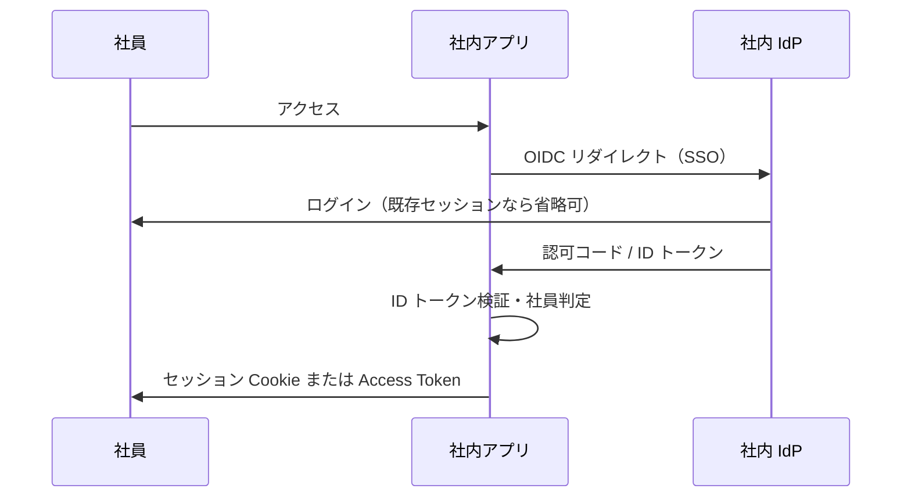
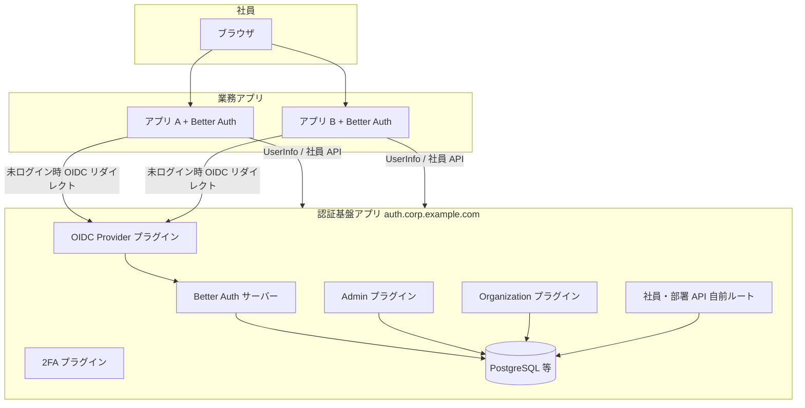
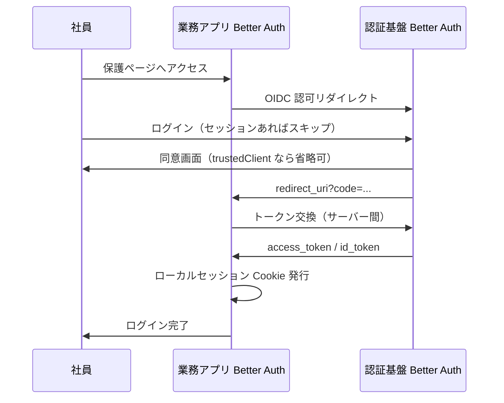
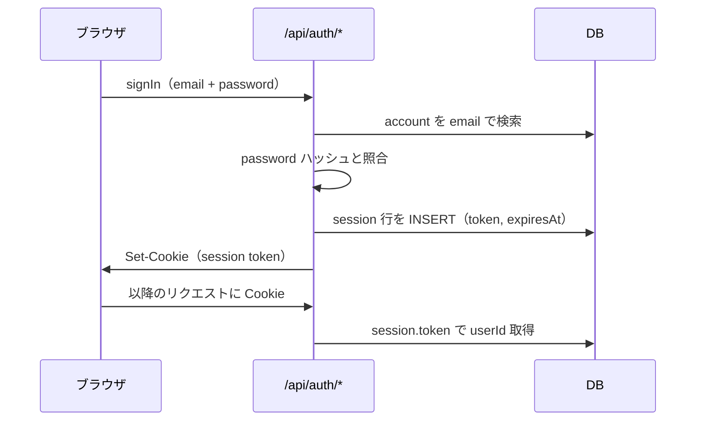

# 社内システム向け認証方式の選び方

社内システムで「社員だけがログインできる」ようにするための認証方式を、モダンな選択肢と OIDC 以外の代替をまとめたメモ。

---

## 結論（モダンな第一候補）

**OIDC + 社内 IdP への SSO** が第一候補。

| やりたいこと | 選ぶもの |
|-------------|----------|
| 社員の本人確認 | **OIDC**（ID トークンで「誰か」を確定） |
| 一度ログインで複数社内アプリ | **SSO**（UX。実装は OIDC / SAML） |
| ログイン後の API 呼び出し | **Bearer + JWT**（Access / Refresh）または **セッション + Cookie** |

「社員だけ」は認証方式そのものより、**どの IdP（アイデンティティプロバイダ）に繋ぐか**で決まる。

- Microsoft Entra ID（旧 Azure AD）
- Google Workspace
- Okta など

アプリは OIDC で IdP にリダイレクトし、返ってきた ID トークンの `email` / `sub` / グループクレームで在籍社員かを判定する。

### 社員以外を弾く典型的な制御

- 許可ドメインのみ（例：`@yourcompany.com`）
- IdP の「全社員」グループ／ロールのみ許可
- 必要なら VPN や社内ネットワークと併用（認証の代替ではなく補強）

---

## 概念の整理（一覧）

| 概念 | 分類 | 一言 |
|------|------|------|
| Basic / Digest | 認証方式（レガシー） | ヘッダで資格情報／ハッシュを毎回送る |
| API キー | 認証方式 | DB ルックアップが必要な不透明キー |
| セッション + Cookie | 認証方式 | ステートフル、古典的 Web |
| Bearer | パターン | トークン保持者にアクセス |
| JWT | トークン形式 | 署名付き・自己完結可能 |
| Access / Refresh | トークン運用 | 短命 API 用 + 長命更新用 |
| OAuth 2 | 認可フレームワーク | 第三者アプリのリソースアクセス許可 |
| OIDC | 認証（+ OAuth 2） | ID トークンで本人確認 |
| SSO | UX パターン | 一度のログインで複数サービス |
| SAML / OIDC | アイデンティティプロトコル | SSO の下層技術 |

---

## 社員ログイン用途ごとの向き不向き

### 向かない・別用途

| 方式 | 理由 |
|------|------|
| **Basic / Digest** | レガシー。社員向け本番ログインの主役にはしない |
| **API キー** | 人間のブラウザログインではなく、バッチ・連携・マシン間向け |
| **OAuth 2 単体** | 認可フレームワーク。社員ログインの本体には **OIDC** が必要（OAuth 2 だけでは「誰か」の保証が弱い） |

### よく使うが「単体の答え」ではない

| 方式 | 位置づけ |
|------|----------|
| **JWT / Bearer / Access・Refresh** | ログイン**後**のトークン運用。OIDC ログインのあと、自前 JWT を発行するかセッションに載せ替えるかの話 |
| **セッション + Cookie** | モダンでも有効（特に社内 Web の BFF 構成）。多くは **OIDC で IdP ログイン → サーバーがセッション発行** |

### エンタープライズでまだ多い

| 方式 | 位置づけ |
|------|----------|
| **SAML** | 既存 IdP・アプリが SAML 固定なら現実的。新規なら **OIDC 優先**（JSON / JWT エコシステムと相性がよい） |

---

## 実務でよくある構成



- **社内 Web 1 本** … OIDC + **セッション + HttpOnly Cookie**（CSRF 対策込み）が扱いやすいことが多い
- **SPA / モバイル / 複数 API** … OIDC のあと **短命 Access + Refresh** が一般的

Microsoft 365 利用なら Entra ID の OIDC、Google Workspace なら Google OIDC、という形が多い。

---

## OIDC 以外に使えるもの

### 同じ「SSO・社内 IdP」系（OIDC の兄弟）

| 方式 | 向き | 補足 |
|------|------|------|
| **SAML 2.0** | エンタープライズ SSO | 既存 IdP・アプリが SAML 固定のとき。XML・リダイレクト型。新規は OIDC が多いが社内では十分現役 |
| **WS-Federation** | Microsoft 系レガシー | Entra / ADFS 周りで残っていることがある |

いずれも「社員だけ」は **IdP 側のユーザー／グループ**で縛る点は OIDC と同じ。

### Web アプリ向け（IdP 連携なし〜弱い連携）

| 方式 | 向き | 補足 |
|------|------|------|
| **セッション + Cookie**（自前 ID/パスワード） | 小規模・社内ツール | DB にユーザー、ログイン後セッション。MFA・退職対応は自前。IdP がなくても動く |
| **LDAP / Active Directory 直接バインド** | オンプレ AD 中心 | アプリが AD に認証。OIDC ほど標準化されていないが社内では昔からある |
| **Windows 統合認証（Kerberos / NTLM）** | ドメイン参加 PC のイントラネット | ブラウザがドメイン資格情報を使い画面なし SSO に近い。社外・Mac では弱い |

### トークン・API 寄り（人のログインの「本体」にはしにくい）

| 方式 | 向き | 補足 |
|------|------|------|
| **Bearer + JWT**（自前発行） | API・マイクロサービス | ログイン画面は別途必要。認証の代わりではなくログイン後の形式 |
| **Access / Refresh** | 同上 | OIDC / SAML / セッションの**後**に自前で発行するパターンが多い |
| **API キー** | バッチ・連携・社内スクリプト | 人間のブラウザログインには不向き |

### レガシー（社内限定なら「使える」がモダン推奨ではない）

| 方式 | 補足 |
|------|------|
| **Basic / Digest** | 社内限定ツール・Postman 程度。本番の社員ポータル主役にはしない |
| **OAuth 2 のみ（OIDC なし）** | 第三者アプリの認可向け。社員ログインの本体には非推奨 |

### その他（条件付き）

- **mTLS（クライアント証明書）** … 極めて閉じた社内 API。ブラウザ一般ユーザー向けには運用が重い
- **VPN + 上記のいずれか** … 「社員だけ」をネットワーク層でも補強（認証方式の代替ではない）

---

## 選び方の指針

| 環境・要件 | おすすめ |
|-----------|----------|
| 既に Microsoft / Google / Okta がある | **OIDC** が第一候補。ダメなら **SAML**（ベンダー・既存アプリの都合） |
| 小さい社内ツール・IdP を立てたくない | **セッション + 自前アカウント** または **AD / LDAP 直結** |
| 社内 Windows PC のみ・イントラネット | **Kerberos 統合認証** も選択肢（OIDC リダイレクト不要） |
| API・ジョブだけ | **API キー** や **サービス用 JWT**（人のログインとは別） |

---

## まとめ

- **モダンで社員限定** … **OIDC で社内 IdP に SSO**（必要なら SAML）
- **JWT / セッション / Access・Refresh** … その**後**にどうセッションを持たせるかの選択
- **自前の ID/パスワード DB だけ** … MFA・退職者無効化・パスワードポリシーを全部自前で背負うため、社員規模なら IdP 連携が一般的
- **OIDC 以外で社員ログインとしてよくあるもの** … **SAML**、**セッション + AD/LDAP**、環境によって **Kerberos**

---

## Better Auth を使った社内 SSO 設計（複数アプリ）

社員マスタ・部署・入退社・権限を **1 つの認証基盤アプリ** で一元管理し、他アプリは **Better Auth + 標準 OIDC** で SSO する構成。  
**プロトコル・暗号・セッションを一から自前実装する案は採用しない**（後述）。

### 用語の整理：IAM / Better Auth / AWS

| 用語 | 何か | 本設計での役割 |
|------|------|----------------|
| **AWS IAM** | AWS リソースへの権限管理サービス | **使わない**（高コスト・本件と無関係） |
| **認証基盤（旧メモの「IAM 基盤」）** | 社員・部署・入退社・権限を持つ **自社アプリ** の通称 | **1 台の Next.js（等）アプリ**として実装 |
| **Better Auth** | TypeScript 向け **認証ライブラリ**（旧 Auth.js / NextAuth 系の後継） | 認証基盤と各業務アプリに **組み込む実装部品** |

**IAM（認証基盤）と Better Auth は別物だが、セットで使う。**

- **認証基盤アプリ** … 社員マスタ・管理画面・SSO の **中心（IdP）** という **役割・データの正**
- **Better Auth** … ログイン・セッション・MFA・OIDC 発行・管理 API を **安全に実装するためのライブラリ**

AWS に課金するサービスではなく、**自社サーバー上のアプリ + OSS ライブラリ** で構成する。

### 「自前は危ない」とは何を避けるか

危しいのは **「認証基盤という名前のアプリを自社で作る」こと自体ではなく**、次をゼロから書くこと。

- パスワードハッシュ・タイミング攻撃対策
- セッション固定・CSRF・オープンリダイレクト
- Authorization Code / PKCE / トークン署名・失効
- MFA・レート制限・監査ログ

**Better Auth を使う = 上記をライブラリと標準プロトコルに委ねる「自社運用の認証基盤」** であり、Entra ID のような **マネージド SaaS IdP** とは別。自社固有部分（部署マスタ・業務権限・入退社 UI）だけを書く。

### ゴールと責務分担

| 責務 | 認証基盤アプリ | 業務アプリ（複数） |
|------|----------------|-------------------|
| 社員・部署マスタ | 正（Better Auth `user` + 拡張 + Organization） | API 参照・キャッシュ |
| 入退社 | Admin `banUser` 等で即時無効化 | Webhook / 同期で追随 |
| ログイン | ログイン画面・MFA・OIDC 発行 | Better Auth が IdP へリダイレクト |
| 権限 | Organization RBAC + カスタム permission | アプリ固有データは各アプリ |
| SSO | OIDC Provider（Authorization Code + PKCE） | OIDC クライアントとして接続 |

### 全体構成



### SSO フロー（Better Auth OIDC Provider）

認証基盤に **OIDC Provider プラグイン** を載せ、業務アプリを **OAuth クライアント** として登録する（外部 Okta / Entra ではなく **自社の Better Auth が IdP**）。



> **注意:** OIDC Provider プラグインは開発が活発。本番前に [公式ドキュメント](https://www.better-auth.com/docs/plugins/oidc-provider) と後継の [OAuth Provider プラグイン](https://www.better-auth.com/docs/plugins/oauth-provider) の安定性を確認すること。

### 認証基盤アプリの Better Auth 設定（例）

| プラグイン | 用途 |
|-----------|------|
| **コア**（email + password） | 社員ログイン。招待制は sign-up 無効 + Admin でユーザー作成 |
| **twoFactor** | TOTP / バックアップコード（MFA 一元化） |
| **admin** | ユーザー作成・ロール・**ban（退職時は全セッション失効）** |
| **organization** | 部署・チーム相当、メンバー・招待 |
| **oidcProvider** + **jwt** | 他アプリ向け SSO（IdP） |
| **databaseHooks** | 社員ドメイン検証、`active` チェック |

```ts
// 認証基盤 auth.ts（概念例・抜粋）
import { betterAuth } from "better-auth";
import { admin, organization, twoFactor, oidcProvider, jwt } from "better-auth/plugins";

export const auth = betterAuth({
  emailAndPassword: { enabled: true },
  disabledPaths: ["/token"],
  plugins: [
    twoFactor(),
    admin(),
    organization({ /* カスタム role / permission */ }),
    jwt(),
    oidcProvider({
      loginPage: "/sign-in",
      consentPage: "/consent",
      useJWTPlugin: true,
      trustedClients: [
        {
          clientId: "app-a",
          clientSecret: process.env.APP_A_SECRET!,
          name: "業務アプリ A",
          type: "web",
          redirectUrls: ["https://app-a.corp.example.com/api/auth/callback/oauth2"],
          skipConsent: true,
        },
      ],
      getAdditionalUserInfoClaim: async (user) => ({
        department_id: user.departmentId,
        permissions: user.appPermissions,
      }),
    }),
  ],
});
```

**社員だけ:** 招待制・社用ドメイン・`banUser`・カスタム `active` フラグ。  
**退職:** `auth.api.banUser({ userId, banReason: "退職" })` → サインイン不可 + 既存セッション全失効。

### 業務アプリの Better Auth 設定（例）

```ts
// 業務アプリ auth.ts（概念例・抜粋）
import { betterAuth } from "better-auth";
import { genericOAuth } from "better-auth/plugins";

export const auth = betterAuth({
  baseURL: "https://app-a.corp.example.com",
  plugins: [
    genericOAuth({
      config: [
        {
          providerId: "corp-auth",
          clientId: process.env.OAUTH_CLIENT_ID!,
          clientSecret: process.env.OAUTH_CLIENT_SECRET!,
          discoveryUrl: "https://auth.corp.example.com/.well-known/openid-configuration",
          scopes: ["openid", "profile", "email"],
        },
      ],
    }),
  ],
});
```

ブラウザ向けは **BFF + HttpOnly セッション Cookie** を推奨。パスワードは認証基盤のみが保持。

### 社員・部署マスタの持ち方

| データ | 実装 |
|--------|------|
| 社員 ID・メール・氏名 | Better Auth `user` |
| 部署 | **organization** の org / team、または `departmentId` カスタムフィールド |
| 入社日・退職日 | カスタムフィールド + Admin UI |
| アプリ横断の権限 | organization のカスタム role / permission + `getAdditionalUserInfoClaim` |

| API（例） | 内容 |
|----------|------|
| `GET /api/internal/employees` | 一覧（サービス間トークン） |
| `GET /api/internal/departments` | 部署ツリー |
| `GET /oauth2/userinfo` | OIDC 標準（ログイン中ユーザー） |

### 認可（権限）

| レイヤ | 担当 |
|--------|------|
| アプリに入れるか | OIDC `scope` / UserInfo の `permissions` |
| 組織内ロール | organization の `hasPermission` |
| 案件の担当者か等 | 各業務アプリ DB |

### SAML が必要な場合

**SSO プラグイン（`@better-auth/sso`）** はアプリを **SAML SP** として外部 IdP に繋ぐ用途。自社認証基盤が IdP で複数アプリに SSO する本構成では、まず **OIDC Provider** で足りる。将来 Entra 連携が必要なら SSO プラグインを追加。

### 入退社・権限変更の伝播

| 手段 | 実装 |
|------|------|
| 即時 | `banUser` / `setRole` / organization メンバー更新 |
| Webhook | 認証基盤から業務アプリへ POST（自前実装） |
| 定期同期 | Admin `listUsers` + `updatedAt` |

### セキュリティ（Better Auth が担う例）

- パスワードハッシュ・セッション管理・CSRF（フレームワーク連携）
- OIDC 標準フロー（PKCE、redirect URI 検証、`trustedOrigins`）
- MFA（twoFactor）、レート制限（設定可能）
- 運用で足すもの: HTTPS、監査ログ、秘密情報のローテーション

### 新規業務アプリの追加手順

1. `oidcProvider.trustedClients` に client 登録
2. 業務アプリに Better Auth + OIDC クライアント設定
3. organization / カスタム permission でアプリ用ロール定義
4. 結合テスト（ログイン → UserInfo → ban 後 401）

### 方式の比較（本要件）

| 方式 | 採用 |
|------|------|
| プロトコル完全自前（独自 code 交換のみ） | **不採用** |
| AWS IAM / Cognito | **不採用** |
| Better Auth + 自社 OIDC Provider | **採用** |
| Better Auth + Organization / Admin | **採用** |
| 外部 Entra / Google | 任意（SSO プラグインで追加可） |
| SAML | 外部 IdP 連携が必要になったら検討 |

### 実装ファイル一覧（Next.js App Router 想定）

「Auth フォルダ」「セッション用ファイル」を自分で書いていた場合、Better Auth では **役割が公式の置き場所に分かれる**。  
**セッションの生成・検証ロジック自体は `auth.ts` と `/api/auth/*` に集約**し、自前で `session.ts` に crypto を書かない。

#### 認証基盤アプリ（1 台）— 最低限ほしいファイル

```
auth-hub/                          # 例: auth.corp.example.com
├── .env.local
├── src/
│   ├── lib/
│   │   ├── auth.ts                # ① サーバー側の認証の「本体」
│   │   └── auth-client.ts         # ② ブラウザから auth API を呼ぶ窓口
│   ├── app/
│   │   ├── api/auth/[...all]/
│   │   │   └── route.ts           # ③ /api/auth/* を Better Auth に渡す
│   │   ├── (auth)/sign-in/page.tsx    # ④ ログイン画面（UI）
│   │   ├── (auth)/consent/page.tsx    # ⑤ OIDC 同意画面（任意）
│   │   └── (admin)/employees/page.tsx # ⑥ 入退社・権限 UI（自前）
│   ├── middleware.ts              # ⑦ 未ログイン → /sign-in へ
│   └── db/schema.ts               # ⑧ DB 定義（CLI 生成が楽）
```

#### 業務アプリ（各 1 台）— 認証基盤より少ない

```
app-a/
├── .env.local                       # 認証基盤の URL、OAuth client_id/secret
├── src/lib/auth.ts                  # ① OIDC クライアント設定（genericOAuth）
├── src/lib/auth-client.ts           # ② signIn / useSession
├── src/app/api/auth/[...all]/route.ts  # ③ 同上
├── src/middleware.ts                # ④ 未ログイン → signIn へ
└── src/app/...                      # ⑤ 業務画面（在庫・経費など）
```

| ファイル | 担うこと | 自分で書く量 |
|----------|----------|--------------|
| **`lib/auth.ts`** | DB 接続、プラグイン（admin / organization / oidcProvider 等）、パスワード・MFA・SSO のルール | 設定が中心（ロジックはライブラリ） |
| **`lib/auth-client.ts`** | ログイン・ログアウト・`useSession()` などフロント用 API | 数行〜十数行 |
| **`api/auth/[...all]/route.ts`** | `POST/GET /api/auth/sign-in` 等 **すべての認証 HTTP** を処理 | **ほぼ定型**（コピペ可） |
| **`sign-in/page.tsx`** | メール・パスワード入力、`authClient.signIn.email()` 呼び出し | UI は自前 |
| **`middleware.ts`** | Cookie のセッションを見て保護ページをガード | 十数行 |
| **`db/schema.ts`** | テーブル定義 | `npx auth generate` で生成推奨 |
| **`(admin)/employees/page.tsx`** | 社員招待・ban・ロール変更 | **完全自前**（`auth.api.banUser` 等を呼ぶ） |
| **`api/internal/employees/route.ts`** | 他アプリ向け社員一覧 API | **自前**（サービス間トークン検証） |

**③ `route.ts` が昔の「Auth ルート一式」に相当する。** ここに sign-in / sign-out / callback がまとまるので、`auth/login.ts` をバラバラに書く必要はない。

**① `auth.ts` が昔の「セッション管理 + パスワード検証」の置き換え。** ただし中身の実装は Better Auth が持ち、ここは設定ファイルに近い。

#### ③ `route.ts` の中身（定型）

```ts
// src/app/api/auth/[...all]/route.ts
import { auth } from "@/lib/auth";
import { toNextJsHandler } from "better-auth/next-js";

export const { GET, POST } = toNextJsHandler(auth);
```

#### ⑦ `middleware.ts` のイメージ

```ts
// src/middleware.ts（概念例）
import { NextResponse } from "next/server";
import type { NextRequest } from "next/server";
import { getSessionCookie } from "better-auth/cookies";

export function middleware(request: NextRequest) {
  const session = getSessionCookie(request);
  if (!session && request.nextUrl.pathname.startsWith("/dashboard")) {
    return NextResponse.redirect(new URL("/sign-in", request.url));
  }
  return NextResponse.next();
}
```

業務アプリでは未ログイン時に **`authClient.signIn.oauth2({ providerId: "corp-auth" })`** で認証基盤へ飛ばす。

---

### DB：何を保存するか（初心者向け）

**原則**

| 保存してよい | 絶対に平文で保存しない |
|-------------|------------------------|
| パスワードの **ハッシュ** | パスワード本体 |
| セッション用の **ランダム token** | セッション token を推測可能な値（連番など） |
| ユーザー ID・メール・部署 ID | — |
| OAuth の **client_secret**（環境変数推奨） | ソースコードへの直書き |

**ブラウザの Cookie に入るもの** … 多くの場合 **セッション token**（またはそれを指す署名付き Cookie）。Cookie だけでは「誰か」は確定せず、**サーバーが DB の `session` と照合**する。

**`.env` の `BETTER_AUTH_SECRET`** … DB には入れない。トークン署名・暗号化用の鍵（32 文字以上のランダム文字列）。

---

### 最低限の DB テーブル（コア 4 つ）

Better Auth 本体が使うテーブル。`npx auth migrate` または `npx auth generate` で作る。

#### `user` — 「社員」その人

| カラム | 意味 | 例 |
|--------|------|-----|
| `id` | 社員の一意 ID（UUID 等） | `clx7abc...` |
| `name` | 表示名 | `山田 太郎` |
| `email` | ログイン ID 兼連絡先 | `taro@corp.example.com` |
| `emailVerified` | メール確認済みか | `true` / `false` |
| `image` | アイコン URL（任意） | `null` |
| `createdAt` / `updatedAt` | 作成・更新日時 | |

**社員だけにしたいとき** … `additionalFields` で `employeeNumber` / `departmentId` を足すか、別テーブル `employee_profile` を `userId` で紐づける。

#### `account` — ログイン手段（パスワードはここ）

1 人の `user` に、Google 連携・メール/password など **手段ごとに 1 行**。

| カラム | 意味 | 初心者メモ |
|--------|------|------------|
| `userId` | どの社員か | `user.id` への外部キー |
| `providerId` | 手段の種類 | メール/password なら `"credential"` |
| `accountId` | プロバイダ側 ID | credential なら often `userId` と同じ |
| **`password`** | **ハッシュされたパスワード** | **平文ではない**。Better Auth が bcrypt 等で保存 |
| `accessToken` 等 | 外部 SSO 用 | メール/password だけなら空でよい |

> 昔「users テーブルに password カラム」としていた構成は、Better Auth では **`account.password`（ハッシュ）** に分かれるイメージ。

#### `session` — 「今ログイン中」の印

| カラム | 意味 | 初心者メモ |
|--------|------|------------|
| `id` | セッション行の ID | DB 上の主キー |
| `userId` | 誰のセッションか | |
| **`token`** | **ランダムなセッション ID** | Cookie と照合する値。**推測困難な長い文字列** |
| `expiresAt` | いつまで有効か | 過ぎたら未ログイン扱い |
| `ipAddress` / `userAgent` | 端末の手がかり（任意） | 不正ログイン調査用 |

**退職・ ban 時** … 該当 `userId` の `session` 行を削除（Admin の `banUser` がやってくれる）。

#### `verification` — 一時的な確認用

メール確認リンク・パスワードリセット・MFA セットアップなど **短命のコード** 用。恒常的な社員データではない。

| カラム | 意味 |
|--------|------|
| `identifier` | 何の確認か（例: メールアドレス） |
| `value` | 確認コード or トークン |
| `expiresAt` | 有効期限 |

---

### プラグインを入れたときに増える表（目安）

| プラグイン | 主な追加テーブル | 用途 |
|-----------|------------------|------|
| **admin** | `user` に `role`, `banned`, `banReason` 等 | 管理者・退職 ban |
| **organization** | `organization`, `member`, `invitation` | 部署・所属 |
| **twoFactor** | `twoFactor` 関連 | MFA 秘密鍵（暗号化して保存） |
| **oidcProvider** | `oauthApplication`, `oauthAccessToken`, `oauthConsent` | 業務アプリを OAuth クライアントとして登録 |

正確なカラムはプラグイン追加後に `npx auth generate` を再実行して `schema` を確認する。

---

### 自前で足すことが多いテーブル（業務用）

Better Auth 外（Prisma / Drizzle で普通に定義）。

| テーブル | 用途 | 主なカラム例 |
|----------|------|--------------|
| `department` | 部署マスタ | `id`, `name`, `parentId` |
| `employee_profile` | 社員属性の拡張 | `userId`, `hiredAt`, `leftAt`, `departmentId` |
| `audit_log` | 監査 | `actorUserId`, `action`, `createdAt` |

`user` に全部載せてもよいが、人事項目が増えるなら分離の方が見通しがよい。

---

### ログイン 1 回の流れと DB の対応



---

### 環境変数（最低限）

```env
# 認証基盤・業務アプリ共通
BETTER_AUTH_SECRET=        # 32文字以上のランダム（openssl rand -base64 32）
BETTER_AUTH_URL=             # そのアプリの公開 URL
DATABASE_URL=                # PostgreSQL 等

# 業務アプリのみ（認証基盤が IdP の場合）
OAUTH_CLIENT_ID=
OAUTH_CLIENT_SECRET=
CORP_AUTH_ISSUER=https://auth.corp.example.com
```

---

### 確認したいこと（設計確定前）

1. 業務アプリは **すべて Next.js** か。
2. 認証基盤の **本番時期**（OIDC Provider プラグインの成熟度）。
3. 部署は **organization の team** か **フラットな department テーブル** か。
4. 社外アクセス（VPN のみか、MFA 付きインターネットか）。

### Better Auth 公式ドキュメント

- [OIDC Provider](https://www.better-auth.com/docs/plugins/oidc-provider)
- [Organization](https://www.better-auth.com/docs/plugins/organization)
- [Admin](https://www.better-auth.com/docs/plugins/admin)
- [SSO（外部 SAML / OIDC）](https://www.better-auth.com/docs/plugins/sso)

---

## 参照

- [[04_開発者が知るべき認証の7つの概念（Hayk Simonyan）]] — 各概念の詳細（Basic、JWT、OAuth 2、OIDC、SSO、SAML など）
