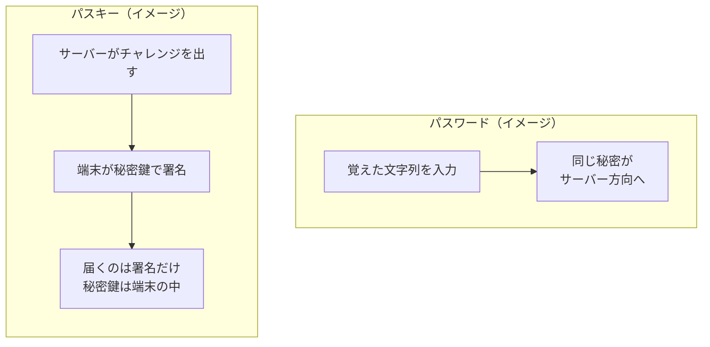
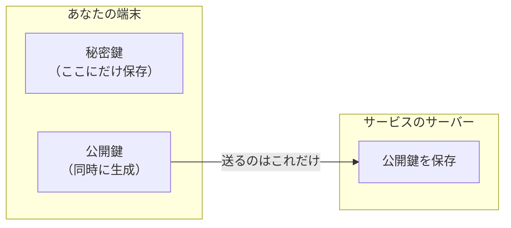
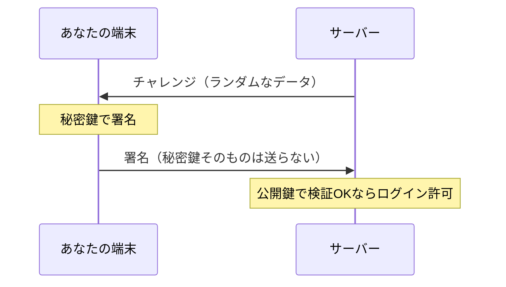

## パスキーとは（解説・初心者向け）

このノートはラジオの文字起こしですが、先に**パスキー**だけを、用語に慣れていない人向けに整理します。長いですが、上から順に読めば全体像がつかめます。

---

### 1. パスワードの「つらさ」を一言で

パスワードは、ログインのたびに**「秘密の文字列そのもの」がどこかに行く**設計になりがちです。入力欄に打つ／サーバー側に保存される（ハッシュ化されることは多いが、原理的には**秘密に近いものを預ける**）／フィッシングでは**偽サイトに同じものを打たせられる**、など、**秘密を運ぶ**ところに弱点が集まります。

---

### 2. パスキーで何が変わるか

**パスキー（Passkey）**は、パスワードの代わりに使うログイン方式で、**FIDO2** やブラウザの **WebAuthn** といった標準に沿って実装されます。

ポイントは次の1文です。

> **「ネットの向こうに『秘密そのもの』を送らず、『本人しかできない合図』だけを送る」**

人が考えて覚える文字列ではなく、端末の中で作られる**暗号鍵のペア（秘密鍵＋公開鍵）**を使います。名前は「鍵」ですが、物理の鍵に近いイメージです。**かぎ本体（秘密鍵）は自分のポケット＝端末に入れたまま**、相手には**合い鍵で試せる片方（公開鍵）だけ**を預けます。

---

### 3. 秘密鍵と公開鍵（超ざっくり）

数学の細部は省略し、**役割**だけ押さえます。

| | 秘密鍵（Private Key） | 公開鍵（Public Key） |
|---|----------------------|----------------------|
| どこにある？ | ユーザーの端末内（外に出さない） | サーバーに登録される（漏れても単体では致命的でない設計） |
| 何に使う？ | 「本人の合図」を作る（**署名**） | その合図が本物か検証する |

**電子署名**のイメージ：サーバーが「今日の合言葉はこれ」とランダムなデータ（**チャレンジ**）を出す → 端末が秘密鍵で「それに対する答え」（署名）を作る → サーバーは**公開鍵**で「この答えは確かにその秘密鍵の持ち主が作った」と確認できる。**答えを見ただけでは秘密鍵が分からない**、という性質を利用します。

---

### 4. 比喩：現金を運ぶ vs 振り込み

パスワードは「大切な現金を**持って**支払いに行く」に近く、途中で奪われると終わりです。パスキーは「**現金は出さず**、銀行が『この取引でいい？』と言ったことにだけ応じる」に近い発想です（本エピソードでも同種の比喩が出ます）。

```text
【パスワード】秘密の文字列そのものが「通信路」を通る
  あなた ──(パスワード文字列)──> 本物のサイト
  あなた ──(同じ文字列)──────> 偽サイト（フィッシング）にも流れうる

【パスキー】通るのは「チャレンジに対する署名」など、秘密鍵そのものではない
  あなたの端末（秘密鍵は中に閉じ込め）
       │
       └── 署名だけ送信 ──> 本物のサイトは検証OK
       └── 偽サイト向けには「別の鍵・別ドメイン」になり、意味が合わない
```



---

### 5. 登録（アカウントにパスキーを紐づける）の流れ

はじめてそのサービスでパスキーを使うとき、端末の中で鍵ペアが作られ、**公開鍵だけ**がサーバーに送られます。



（秘密鍵は端末から外に出さず、ネット越しに「秘密鍵ファイル」を送ることはありません。）

---

### 6. ログインの流れ（チャレンジと署名）

ログイン時、サーバーは「このランダムデータに答えを出せ」と**チャレンジ**を出します。端末は**秘密鍵で署名**し、署名だけを返します。サーバーは保存していた公開鍵で検証します。



---

### 7. 生体認証（指紋・顔）の位置づけ

よくある誤解：**「指紋データが楽天やGoogleのサーバーに送られるのでは？」**  
多くの場合、**送られません**。

流れは次のようなイメージです。

1. サーバーはチャレンジを出す（指紋ではない）。
2. 端末が「パスキーを使って署名しようとしている」。
3. 端末OSが「この端末の**本人**か？」を**端末の中だけ**で指紋・顔などで確認する。
4. OKなら、端末が秘密鍵を使って署名する。

つまり**生体は“端末の鍵を使っていいか”の鍵束**のようなもので、**パスキーの本体はあくまで秘密鍵**です。サービス側に「指紋のデータそのもの」が届く、とは限りません（実装はOS・端末依存ですが、**WebAuthnの普通の説明**はこの整理になります）。

---

### 8. フィッシングに強い理由（ドメインと鍵の対応）

パスキーは**サイト（正確にはドメイン等）ごとに別の資格情報**です。本物の `example.com` 用に作った鍵で、攻撃者の `examp1e.com` 用のログインを完了させる、というのが**構造上つながりにくい**、というのが大きな点です。

偽サイトがチャレンジを送っても、**本物のサービスが出したチャレンジではない**／**鍵の紐づきが別**、などの理由で、攻撃者が「そのまま横流ししてログイン完了」といきにくい、と理解するとよいです（※高度な中継攻撃の話は別レイヤの議論になります）。

---

### 9. 複数端末・QRコードのイメージ

パスキーは「スマホ1台時代」には普及しにくかった面もあります。今は**同じパスキーを複数端末で使える（同期する）**仕組みや、PCに鍵がなくスマホにあるとき**QRでスマホ側に認証を回す**、といった運用があります。**「QRを読む＝それ自体がパスキー」ではなく**、あくまで**どの端末の秘密鍵で署名するか**の都合で画面が出る、と捉えると混乱しにくいです。

---

### 10. まとめ（箇条書き）

- **パスキー**＝パスワードの代わりのログイン方式（FIDO2 / WebAuthn 系）。
- **秘密鍵は端末に残し、公開鍵だけサーバー**という分担。
- **ログインは「チャレンジへの署名」**で、秘密そのものは送らない。
- **指紋・顔**は多くの場合、**端末が秘密鍵を使う許可を出すため**の確認。
- **サイトごとに鍵が違う**ため、フィッシングに対してパスワードより有利な設計になりやすい。

以下は本エピソードの説明文・文字起こしです。

---

パスワードはずっとセキュリティの大敵でした。そして今、死につつあります。  
  
【目次】  
0:00 生き残るセキュリティの大敵  
4:58 パスワードはなぜ弱いのか？  
12:21 パスキーの仕組み  
21:04 『DEATH NOTE』はパスキーの啓蒙？  
30:02 パスキーの誤解を解く  
36:40 啓蒙ではなくフールプルーフ  
  
【参考文献】  
◯FIDO Alliance「Passkeys」  
https://fidoalliance.org/passkeys/  
  
◯大和総研WORLD: パスキーとは？FIDO認証との違い、3つのメリットと課題  
https://www.dir.co.jp/world/entry/passkey  
  
◯FIDO Alliance「White Paper: Multi-Device FIDO Credentials」  
https://fidoalliance.org/white-paper-multi-device-fido-credentials/  
  
◯Web Authentication: An API for accessing Public Key Credentials Level 3  
https://www.w3.org/TR/webauthn-3/  
  
◯日本経済新聞「投資家テスタさん、口座乗っ取り「個人・証券会社とも防犯意識向上を」」  
https://www.nikkei.com/article/DGXZQOFL031XUTT00C25A5000000/  
  
◯FIDO Alliance Champions Widespread Passkey Adoption and a Passwordless Future on World Passkey Day 2025  
https://fidoalliance.org/fido-alliance-champions-widespread-passkey-adoption-and-a-passwordless-future-on-world-passkey-day-2025/  
  
◯etymonline「fool-proof」  
https://www.etymonline.com/word/fool-proof  
  
◯DEATH NOTE3巻  
https://amzn.to/3Oh8GnN  
  
◯DEATH NOTE4巻  
https://amzn.to/4dpSbAa  
  
【サポーターコミュニティへの加入はこちらから！】  
https://yurugengo.com/support  
  
【親チャンネル：ゆる言語学ラジオ】  
https://www.youtube.com/@yurugengo  
  
【実店舗プロジェクト：ゆる学徒カフェ】  
https://www.youtube.com/@yurugakuto  
  
【お仕事依頼はこちら！】  
info@pedantic.jp  
  
【堀元見プロフィール】  
慶應義塾大学理工学部卒。専攻は情報工学。理屈っぽいコンテンツを作り散らかすことで生計を立てている。  
Twitter→https://twitter.com/kenhori2  
noteマガジン→https://note.com/kenhori2/m/m125fc4524aca  
個人YouTube→https://www.youtube.com/@kenHorimoto  
  
【水野太貴プロフィール】  
1995年生まれ。愛知県出身。名古屋大学文学部卒。専攻は言語学。本業は雑誌編集者。著書に『会話の0.2秒を言語学する 』（新潮社）などがある。Podcast「神保町で会いましょう」のパーソナリティも務める。  
Twitter→https://x.com/yuru\_mizuno  
神保町で会いましょう→https://open.spotify.com/show/6cYkvDO0HnJKLPgDBGUjjS  
  
【姉妹チャンネル】  
◯ゆる音楽学ラジオ(https://www.youtube.com/@yuruongaku)  
◯ゆる民俗学ラジオ (https://www.youtube.com/@yuruminzoku)  
◯ゆる天文学ラジオ (https://www.youtube.com/@yurutenmon)  
◯ゆる生態学ラジオ (https://www.youtube.com/@yuruseitai)  
◯ゆる哲学ラジオ (https://www.youtube.com/@yurutetsugaku )  
  
#パスキー #passkey #ゆるコンピュータ科学ラジオ

## 詳しい要約

**テーマ：パスワードの構造的な弱さと、それを原理的に解決するパスキーの仕組み**

60 年近く「セキュリティの大敵」と言われながら生き残ってきたパスワードに代わり、ここ数年で **パスキー** が急速に普及している。パスワードの本質的な問題は「機密情報そのものを送ってしまう設計」にあり、パスキーは電子署名によって秘密を一切送らずに本人確認する。人間の賢さに頼る「啓蒙」ではなく、誰が使っても失敗しない **フールプルーフ** な技術だ、という結論。

---

### 生き残るセキュリティの大敵（0:00〜）

- パスワードは使い回し・脆弱なパスワード・辞書攻撃などで乗っ取られ続けてきたが、人類は長年いい代替手段を持てなかった。
- パスキーは生体認証（顔・指紋）とは **概念として別物**。生体認証はパスキー認証の中で使われることがあるだけ。
- 楽天証券が乗っ取り被害後に導入した「イラストを 2 枚選ぶ」方式は急場しのぎで、現在はパスキーへの全面移行を進めている。
- パスキーのアイデア自体は数十年前からあったが、複数デバイスを持つのが当たり前でなかったため普及しなかった。ただし端末 1 台でもそれなりに機能する。

### パスワードはなぜ弱いのか（4:58〜）

- 本質的な問題は **重要な機密情報をそのまま送っていること**（暗号化はされていても）。
- 攻撃の余地が多い：
  - 入力時の覗き見、パスワードマネージャーへの攻撃
  - サーバー側に保存されるパスワード関連情報（ハッシュ値など）の漏えい。運営者のリテラシーが低いと平文保存されていることもある（堀元氏自身、初期の個人開発サービスで平文保存していた）
  - **フィッシング詐欺**：偽サイトを作れば、そこにパスワードを送らせることができてしまう
- 比喩：パスワードは「家を買うのに現金を持ち歩く」ようなもの。大切なものは取り出さず **銀行振り込み** で済ませたい → それがパスキーの発想。
- セキュリティに敏感な人は退会時にアカウント削除まで求める。ブライアン・カーニハンはブラウザの JavaScript を全部オフにして使っているという逸話も。

### パスキーの仕組み（12:21〜）

- サイトに登録するときに **秘密鍵と公開鍵** のペアを作る（以前の回で扱った公開鍵暗号・RSA 暗号の話の延長）。
- 公開鍵暗号の逆の操作である **電子署名**：秘密鍵で処理したデータを公開鍵で元に戻せれば、秘密鍵の持ち主本人が処理したと検証できる。
- ログインの流れ：
  1. サービス側がランダムなデータ（**チャレンジ**）を作って「これに署名してみろ」と言う
  2. ユーザーは端末内の秘密鍵で署名し、結果を返す
  3. サービス側は公開鍵で検証し、元のチャレンジに戻れば本人と認める
- **機密情報は一切送っていない**ので、サーバーがハッキングされても秘密は漏れない。運営者のリテラシーに依存せず **原理的に漏れない**。
- QR コードが出るのは、パスキーがスマホにしか入っていない場合に「スマホで認証して」と求めているから。端末ごとに別パスキー／同期して共有／スマホのみ、などケースはさまざま。
- どんなに愚かな使い方をしても事故にならない設計を **フールプルーフ（対バカ性）** という。電動シェーバーが肌を切らないのと同じ。PEBKAC（問題は椅子とキーボードの間にある）問題もカバーできる。

### 『DEATH NOTE』はパスキーの啓蒙？（21:04〜）

- 堀元氏の独自の読み：ミサがテレビ局に「指定時刻にキャスターが死ぬ」というビデオを送り、ノートそのものは見せずに所有を証明した場面は **パスキー認証**（チャレンジに応えて本人性を示す）。
- その後ミサがノートを直接ライトに見せに行ったのは **パスワード認証**（秘密そのものを見せる）で、これが原因でマークされ捕まる。
- 作中では一貫して「ノートという秘密を持ち歩いた者から捕まる」。死神（リューク）は所有者にしか見えない＝秘密のメタファー、という読みも出る（半ば冗談として展開）。

### パスキーの誤解を解く（30:02〜）

- 誤解：「指紋情報がサービスのサーバーに保存される」→ **送られない**。指紋はスマホの中だけで照合され、「秘密鍵を使ってよいか」の確認にすぎない。**パスキーの本体は端末内の秘密鍵**。
- フィッシング耐性：偽サイトが独自のチャレンジを送っても、答えは本物のサイトにとって無意味。
- 中継攻撃（本物のチャレンジを横流し）も、パスキーは **サイト（ドメイン）ごとに別の鍵** なので成立しない。偽ドメインにはそのドメイン用の鍵で署名してしまうため、本物では使えない。
- パスキーは **人から切り離されている**：自分で設定せず、覚えず、入力しない。仕様上オーナーですら秘密鍵に触れられないのが望ましいとされ、ソーシャルエンジニアリングで「読み上げさせる」こともできない。

### 啓蒙ではなくフールプルーフ（36:40〜）

- 「強いパスワードを使おう」と呼びかける **世界パスワードデー**（毎年 5 月第 1 木曜）を 10 年以上続けても被害は減らず、2025 年に **世界パスキーデー** に切り替わった。
- 啓蒙（人を賢くする）より、そもそも間違えられないようにする方が正しい、というエンジニアリング精神の表れ。
- 技術者は啓蒙を「効果が限られる生ぬるい策」と見がちで、人文学・政治の世界とは「啓蒙」の響きが真逆になりうる、という対比で締めくくる。確定申告（予定納税の二重払いなど）もフールプルーフにしてほしい、との雑談も。

### まとめ

- パスワードの弱点は「秘密そのものを送る」設計。パスキーは **チャレンジへの署名** だけを送り、秘密鍵は端末から出さない。
- 生体認証は秘密鍵を使う許可のためのローカルな確認で、サーバーに生体情報は渡らない。
- サイトごとに鍵が異なるため **フィッシングがほぼ無力化** される。
- 人の注意力に頼らない **フールプルーフ** 設計だからこそ強い。証券会社などは早めにパスキーへ切り替えるべき。

## Transcript

### The Surviving Enemy of Security

**0:05** · セキュリティの体だから駆逐しなきゃいけないと何十年も言われているのにつまでも駆逐されないものがあります。 何でしょう?

**0:12** · うん。悪意を持ったハッカーとか。あ あ、でもそれも駆逐しなきゃいけないね。 あれ許せないね。 それも1つ答えではあるんですが、 今回僕が用意してきた答えはパスワードです。 パスワード。 パスワードがセキュリティの体なんじゃないかと。 もう60年近く言われ続けてるんですよ。 だってみんなどんなに言われてもパスワード使い回し続けるし、脆弱なパスワード設定し続けるし はいはい。 そのせいで円々遠乗っ取られ続けてるよね。 ちょっと前にランサムアの回かなんかの時言ってましたよね。そのパスワードとして使われやすいパスワードランキングみたいなのが上から順に当たってくみたいな。 ハッキングって何やってるのっていう回ですね。 で、辞書攻撃っていうよく使われるパスワード出リストがあるからそれを上から当たっていくっていう攻撃を紹介しました。 はい。 だからそういう攻撃も知られてるようにパスワードってやばいんですよ。 パスワードのせいで弱になってるものたくさんあってなのに人類はこの 60 年ずっといい代替体手段を持てずに来てしまったんですよ。 うん。うん。 しかしもう時代が変わりました。実はここ数年で大体技術が劇的に普及しつつある。 はい。 その技術の名前はパスキー。パスワードが抱える知名的な問題を解決してくれる新技術です。 なるほど。これみそさんイメージある?

**1:17** · あのさ顔認証とか指紋認証とか正門とか盲膜交際認証みたいな色あるじゃん。うん。 生体認証ってやつ。 生体認証。あれはパスキーと別の?

**1:27** · えっとねとしては別物ですがパスキー認証の中に生態認証が使われます。 誰だら喋んなりますか?概念としては異なります。概念としては異なりますがパスキー認証の中でも使われます。 うん。誰だ?喋っていいですか?スパッて喋ってください。 いや、これありがちなで実際パスキン認証と生態認証の区別ついてない人多いんだけど全くの別物です。 うん。あ、そうなんだ。 パスワードを代替するって言ったら真っ先にみんな買うのは顔認証とかになっちゃいますね。 はい。はい。はい。ま、部分的にね、パスキーにそれは取り入れられたりもしますが、それはパスキー認証そのものではありません。 うん。だらだら喋るのやめていすわ。うん。ちょ、 楽しくなっちゃったな、これ。え、これさ、最近さ、証券会社のログインとかでめちゃくちゃ求められるのよ。 えっと、ログインをしようとすると 8 枚ぐらいイラストみたいなのがあって、そのうちの 2個を その求められた順番でつやですか?

**2:11** · それじゃないす。 それ2段階認証だから。それただA を選ぶやつね。 豚さんと信号機とか押して。 そうそう。押すやつね。あれ楽天証券が一時期取り被害でさ、大変なことになったから馬場しのぎで腰えられただけのシステムです。 あ、そうなの?なんかあれ楽天以外どこも採用してないじゃんて思ったけど。 そうだってあんなんさ2 枚のイラスト選ぶだけだからさ、組み合わせが高知れててさ、バカみたいじゃない?

**2:32** · あれ導入された時バカみたいじゃないって技術クラスターで言われてましたよ。 そうだったんだ。リチ儀に打ってるけどあれじゃないんだ。 でも楽天証券はちゃんとあれは旧馬橋しの木ですと、もっとちゃんと根本的な解決しますって言って、最近はパスキー認証への移行を全面的に進めています。 そうでしたか。 みぞさんまだ設定してない?

**2:49** · してないかも。あの未だに絵打ってます、僕。ログインするたびにさ、パスキー認証強くお勧めしますってお知らせ来てるはずですよ。 俺の目には株価しか見えない。今なんかかっこいい感じになったな、今。ごめんなさい。かっこいい感じのこと言っちゃっ 確かにちょっと口説いてるみたいになりましたね。君しか見えないみたいな。 俺の目には株価しか見えない。最低の口き文句だな。 証券会社よくさ、重要なお知らせみたい来るじゃん。 あれの中にめちゃくちゃ来てるんですよ。今パスキー認証設定してない人はしてくださいね。これパスキー認証はむちゃくちゃ乗っ取りに強くてパスワードよりもはるかに乗っられるリスクを小さくできる優れた認証なので証券会社もそうだし色々なウェブサービスが今どんどんパスキーに移行しようとしている。 ふーん なのにこのすさがいまい社会に伝わってなくて めんどくせえなって言って移行してない人が多そう。水野さんも含めてね。 はい。 これが問題なんで結局何がすごいのか今日それを語ろうと思います。 ちょっとそもそもスキー認証が何か分かってないけど、 QRコード読み取るやつ。 あ、そうそうそうそうそうそう。 はいはいはい。 あのなんかログインするぞってなった時にスマホで QRコード読んでくださいって言われる。 そうそう。スマホで下からニョぎってQR コード出てきて読んだらいける。確定申告する時にめっちゃ QR コード読まされたけど、あ、それは違う。アプリへのリンクだ。全然関係ないです。えっと、ただいまですね。え、ご情報が含まれていました。誠、 言った瞬間訂正するなら言う前に気づいてくれよ。ほんの 0.2秒なんだから。 まあまあでもとりあえずスマホに QR コードが出てきて読んだらなんか認証されるあの謎のやつだね。 あ、そうそうそうそう。それの中身何が起こってるか全然わかんないでしょ。 わからんね。全然。なんでその QR コード読んだら認証と見なされるのかもわからんから。あとさ、あれさ、スマホ 1 台しか持ってない人気の毒じゃない?スマホに QR コードが出てきて読んでくださいって言っても読むデバイスない人つまん。あれ?

**4:23** · あ、それね、めちゃくちゃ本質的な問いです。 あ、そうなんだ。 というかパスキー認証ってアイデア自体はもう何十年も前からあったのよ。 なんだけどいまいち社会に入りきらなかった理由の 1 つがみんなが複数デバイス持ってるのが当たり前じゃないっていう時代だったんですよ。今それがクリアされたからそれで急速に普及が進んでいるってもあります。 そうですよね。僕はいくつか持ってるんでバスキ認証できるんですけど持ってない人があれ出先で求められたりしても無理やんってめっちゃ思ってたんで。 ま、ただねさんのイメージはちょっと間違っててスキーが何なのかが多分イメージ間違ってるからちょっとその後も解きたいですね。実際には端末 1台でもそれなりに機能しますよ。 ふーん。パスキーのすさに行く前にまずパスワードはなぜのかを考えたいんですよ。 はい。 パスワードの本質的な問題点はパスワードという重要な機密情報をそのまま送っちゃってること。 ああ、暗号化せずにと。 えっとね、暗号化はしてるんですよ。 してるんですけど外に出したくない機密情報なわけじゃん。 パスワードは。 うん。 でもそれを送っちゃってるわけよ。 ああ、分かったぞ。称号しなきゃいけないですもんね。 の送られてきたパスワードと登録したパスワードがってたら情報を返すって仕組みになってるわけだからパスワードっていうスキームを使った時点で仮に悪意のある偽サイトを作った人間がいたとしたらパスワードうそうことだからパスワードってめちゃくちゃ重要な情報の割にみんな送りまくっちゃってるわけよ。 ああ、視点だね。 それよく考えたら設計やばくない?

### Why are passwords weak?

**5:41** · 視点 これだからさの余地がむちゃくちゃあってさ、まずユーザーが入力するところね。 はい。 ユーザーが入力してる段階で画面後ろから覗き込んだりとか キーボード叩いてる手を覗き込んだりすればあ、こいつのパスワードこれなんだって見えちゃうわけじゃん。 はい。あとパスワードマネージャー攻撃したらもう勝ちだよね。 そうそう。それもありますね。とかあとサーバーに保存するから。 どこのサーバーに保存する?

**6:03** · 例えばTwitterならTwitter で会員登録した時にパスワード送るじゃん。 はい。 で、その認証情報をサーバー上に記録するよね。 だからTwitter のサーバー攻撃したらまずいって話をしてるですか?

**6:12** · そうです。ま、これ実際にはパスワードを暗号化せずに保存することってまずなくてパスワードそのものが保存されてはいないんだけどずれにせよスワードを発化するつまりこのパスワードが来たらこれに変換されるなみたいな値とか保存されたりしてるからパスワードに関連する情報は保存されちゃってるわけですよ。 うん。ハッシュ化は少し前にやりましたよね。 1方向性がある都合化。 そう。パスワードからハッシュ値にすることはできるが、ハッシュ値からパスワードに戻すの難しいみたいなやつね。 うん。てことだよね。 でもどっちにしろさ、一旦パスワードをサーバーが受け取っちゃってそれに紐づく情報を記録しちゃってはいるわけですよ。 だからこれ攻撃されるとその発値が漏れるっていうのもセキュリティリスクになるし なったらこれサービス運営者がボンクラだったらそのまま記録しちゃってるケースもあるから ああはいはいあのハせずに 自分そう自分が登録したパスワードがそのまま漏れる可能性もあるわけですよ。 うん。 え、でも例えば堀本さんがご自身で開発された紐になりたい男性と紐を買いたい女性のマッチングサービス、神ゆいなんかはパスワードをきっちり発化してセキュリティリスクにも対応しました。 もちろんです。あれはちゃんと僕が発化するように書いて あ、すごい 仮に優出しても問題ない形になってたんですけど、もちろん僕が人生で初めてリリースしたわけわかんないでちっちゃいウェブサービスは平分で保存してたので流出したらそのまま出します。 あれ危なかったね。 ちなみにな、何ていうサービス?

**7:22** · ケナスっていう はい。 あの悪口を投稿するサイトですね。 です。ごめんなさい。ごめんなさい。なんで あのその当時ポメルっていうサービスが流行ってて ああ 登録するとその人を褒める言葉がいっぱい届くっていう めっちゃ面白いコンセプトですね。 あまりにつまんなすぎてなんてつまんないんだと思って僕真逆のケナースっていうサービスを急いで作ったんですよ。丸 2日ぐらいで あれ大変だった急いで丸 2日24 時間行動かき続けて頑張ってリースしたんですよ。楽しかった。 どうしても逆のことやりたいっていう。 いいですね。1 円にもならないしましたね。あん時とかは僕にウェブサービスの常識もないし、急いで作ったせいでパスワードそのまま保存するみたいになってた気がするな。 なるほどね。うん。うん。まだそういうサイトもあると。 そう。だから開発者のリテラシーがないとそもそもパスワードがそのまま漏れる可能性がある。 これたまにね、でかい会社でもひら分でそのまま保存していて、そのまま流出しちゃったってニュース聞くからんや個人開発のサイトやですよね。 うん。なるほど。 つまりユーザー側がパスワードを登録するということ自体にリスクがあるってことを理解しなきゃいけないんよね。僕なんかは全然してなかったけれども、ここにパスワードを登録したらこいつがちゃんと管理してるかどうか分からないぞっていうリテラシを持ってなきゃいけないんだ。 そう。だからめちゃくちゃセキュリティ気にする人はアカウントを削除してくださいって言ったりもする。 ん、 ゆ言語、ゆるコンピューターグラジオ、サポーターコミュニティってさ、月額 1000 円で課金取ってるわけですよ。で、やめたいって言ったらすぐボタンでやめれるんだけど、やめた後にいや、すいません。 これやめるだけじゃなくてアカウント消して欲しいんですけどっていう人たまにいる。 へえ。でもね、一見するとなんでめんどくさって思うけどその人むっちゃリテらしあるってこと。 そう。その人はむちゃくちゃセキュリティを気にする人なんだなって思いますね。 あ、え、てかさ、例えばですけど繊細な方とかいるじゃん。その大きい音とかがすごい気になっちゃうとか、気圧の変化とか花粉とかすごい気になるってあるけど、セキュリティが繊細な人っているんだよね。 いますよ。 っていうかさ、ブライアンカーニハンっていう超有名なコンピューターサインティストがいるんだけど、カーニハンってセキュリティが気になりすぎて、ブラウザの JVASCRIPT を全部オフにして使ってて、 つまり我々が普段見る派手なブサイトとかが全部表示できないガビガビの状態で常に暮らしてるらしいですよ。 なんで?

**9:25** · いや、気になるからセキュリティは Javascript をするとセキュリティ向上すんの?

**9:29** · ま、期戦の動作が全然なくなるから、それを避けるためにもう崩れまくったレイアウトとか動作しないウェブサイトの中で暮らしてるっぽい。 なんか行きづらいね。ねえ、 だからセキュリティ気にしまくるとそうなるんだなっていうのを俺この人の本読んでと思った。うん。 うわあ。でもなんか逆にセキュリティをこんなに気にしない俺ってなんかを失ってんのかもね。 ま、み野さんは個人情報取られまくりですよね。無防美に。 いや、でも俺別にそのカタールからログインされてたことしかないよ。別に全然 されてただろ。お前それ慌ててたもんね。なんか俺昨日カタールから不正ログインされてたんだけど。 そうそうそう。面白いよね。ねえ。笑った笑ったあるわ。 みぞさんはそうあってほしいす。あなたは交渉しないでほしい。リテらし。一生地ジべタをい回りテらし見てほしい。 その方が面白いから。 そうですね。あの、これ多分関係ない話だと思うんですけど、大学 2年生の時に携帯を最新 iPhoneに変えて騎種代20 万ぐらいかかって、その 3 日後ぐらいに飲み会えに行って、そのまま寝て起きたら全然知らない駅にいてスマホなくなってたことはありますね。関係ないですね。ただの酒癖悪いエピソードですね。 で、iPhone 探すの機能そもそもオンにしてなかったせいでどこにいたかわかんなくて取り返せなくてただただローンを払い続けてたってことがあったぐらいですね。 20 万のローを無駄に払い続け、20 万の払い続きましたね。 それはね、人生のリテラシーが低いですね。そのセキュリティへのリテラシーとかじゃなくて、ていうか人生の品格が低いだけです。リテラシーとかじゃなくて、 いや、多分個人情報も抜かれた可能性あると思いますね、あの時に。 あ、確かにね。スマホなくしてるからね。 ついでにね、そう、ついでに失ったとは思います。はい。 ま、でも20万失った方が痛いでしょ。 痛い。 個人情報別に割とどうでもいいもんなみさん。 そうですね。 だから話戻すとパスワードって世に出しちゃいけない機密情報を送っちゃってるっていうこの設計に無理があるんですよね。 うん。うん。 で、さっきみ野さんも言ってくれたけどさ、偽サイト作ってさ、 ID とパスワード入れさせてログインさせようとしたらさ、それだけで奪えちゃうわけじゃん。 ちなみにこれな、何て言います?

**11:09** · フィッシング詐欺。 あってます。あってます。 危ねえ。危ねえ。 ギリギリセーフれよ。それは 危ねえ。 あってます。あってます。それをフィッシング詐欺と言いますね。 フィッシングって魚は釣るのフィッシュですよね。だからニサイトで釣り上げるってことです。 そう。釣り餌としての偽サイトってことですね。だからこれもパスワードを送っちゃってるせいじゃん。 うん。 本来のサイトにパスワードを送るっていう設計になってるせいで偽サイトを立てればそっちにパスワード送らせることができちゃう。 うん。 まずいですよね、設計として。 うん。ただ、ま、パスワード前の時代に僕生まれてるので、それ仕方なくないというか、もそういうもんじゃんて思ってましたけどね。 そうだね。これみさんの感覚って自然で俺たちずっとパスワードを送り続けてきたから疑問を持ってないわけよ。 はい。 でもよく考えたらさ、取られたらまずい密情報を持っていくってさ、結構やばくてさ。 うん。 家買うために現金持ってくみたいなもんなわけですよ。 うん。うん。 途中で取られたりとかしたらやばいよねと。 だから家買う時は現金持ってくんじゃなくて 振り込むてことですよね。銀行振り込みにする。つまり大切なものはなるべく取り出さないっていう思想が我々にあるわけですよ。 はい。 パスワードでも同じことをやりたいわけ。 うん。 取り出さずに認証だけをしたい。 うん。 そのアイデアがパスキーです。 ふーん。 秘密情報そのものは送らずに現金を引き出さずに銀行振り込みで済ませるみたいなアイデア。 なるほど。 じゃあ、パスキー認証の仕組みは何なのかと言うと、これからパスキーを作るぞ、登録するぞっていう書を始めるわけですよ。 今のそのパスキー作るぞってのはパスワードみたいなサイトに登録する時に作るものなのか、それともこうログインをしようとした時に作るものなのかどっちなんすか?

### How Passkeys Work

**12:35** · えっとね、サイトに登録した時に作るもんですよね。 あ、サイトに登録した時にパスキーを持つんだ。 そう。 はいはいはい。 パスワードの代わりだから登録するぞっていう時にパスキーを作ると思ってください。 なるほど。 このパスキー作るぞって作業をすると秘密鍵と公開鍵が作成されます。 なんかそれ聞いたことあるな。 暗号の回とか出てきたやつです。 はいはいはい。公開鍵はネット上で誰でも見ることができるんだけど、みんながそれぞれ秘密鍵を持っていて、で、なんとかするとすごく席になるみたい話だったよな。 曖昧だな、これ。非対象な暗号の面白いとこで公開鍵を使って暗号化は誰でもできるんだけど、その暗号化は秘密を知っている人しか戻せない、複合はできないっていう非対象なものを使えばネット上で知らない人とも問題なく通信ができるっていう文脈で紹介しました。はい。 だから昔の暗号ってさ、どうやって解き ましょうねを僕と水野さんの間で事前の 合意がないと複合できなかったんだけど この公開によって事前の合意なしで僕の 公開ですて僕が公開しておけばみんなを 使って暗号化して僕に送り付けることが できるだからネット上で誰とでも暗号化さ れた安全な通信ができるようになったよし 。はい。 多分そこで紹介したのは疎因数分解かな。 あ、はいはい。 素因数分解ってめっちゃでかい数だと効率よく分解するアルゴリズムがないから僕の手元には分解された 2 つの数があってそれを書け合わせた超でかい数だけが公開鍵として公開されている。それを使ってみんなが暗号を作れば僕だけが素因数分解されたものを知っていてそれを元に戻せるっていう RS 暗号とかを紹介しましたね。うん。はい。 で、これの逆みたいな操作もあってさ、それ電子署名って言われてるんだけど、今度は逆になんか特定のデータを僕が秘密を使って暗号化みたいなことをすると 自分のやつね。 うん。で、そうするとみんなはこの公開鍵を使って複合できる、元に戻せる。 へえ。 これやるとさ、何が嬉しいかと言うと、僕がちゃんと本人であること証明できるんですよ。 ああ、割れるから。その堀さんの秘密鍵で イメージだから秘密鍵と公開鍵を掛け合わせて世の中に出していってでその後誰かは公開鍵で割れば堀さんの秘密鍵が得られて うん。そうだね。ま、秘密鍵得られたらまずいんですけどね。 まずい。秘密。 これは大問題だ。ない。 でもま、そういうことよ。だから秘密がないと絶対にできない処理をして世の中に出して僕の公開学を使ってそれを検証できる。 はあ。うん。うん。うん。 だ、たどり着くのは秘密じゃなくて僕が秘密鍵を使って施した操作によってそれを取り除く操作を公開鍵でできて元のデータに戻せるみたいな感じですね。 はあ、なるほどなるほど。 だからま、今日はいい天気だみたいなファイルを僕の秘密鍵なしで暗号化しちゃうと僕の公開鍵で戻すとめちゃくちゃになっちゃうわけ。 うん。うん。うん。僕の公開鍵ですけど、みんなの公開鍵ですよね。 いや、僕の公開ですね。 公開鍵も1人1 個あの、そう、鳥の公開鍵。 はいはいはい。 だから他の人の秘密鍵で署名したものを僕の公開鍵に戻すとめちゃくちゃになっちゃうから。 うん。 ちゃんと意味あるものになったってことはちゃんと僕の秘密を使って暗号化されたんだなってことが分かるわ。 はあ。ああ、なるほどなるほど。 これが電子書名のイメージ。 ちょっと前提長くなっちゃったんですけど、この電子書面を使ったのがパスキー認証の仕組みです。 うん。 例えば僕が楽天証券にログインしようとしたらさ、楽天証券がその場でランダムなデータを作るんですよ。意味のないデータ。 うん。 で、これチャレンジって呼ばれるんだけど、お前これに署名してみろよって言うんですよ、僕に。 で、僕は僕の秘密鍵、パスキーの秘密鍵を使ってそれに署名を施します。 これは演算をするんですよね。掛け算とかをするんですよね。はい。 そう。で、作り上げた署名したデータを楽に渡します。 署名したデータってのは演算結果ですね。 そうです。 で、楽天証券側は僕の公開鍵を使ってそれを検証します。 割ると うん。で、元のデータにちゃんと出てきましたと。 割った後の結果が 最初のチャレンジに戻った てなるとあ、ちゃんとお前本人だなって分かります。 なるほど。 これがパスキ認証。 うん。うん。うん。うん。 これ最初のパスワード認証と全く違うの分かります?

**16:06** · まず登録みたいなのしてないもんね。 持ってる鍵だけで楽天証券はだから堀モさんの公開鍵だけしっていう状態でその公開鍵は別に誰がアクセスしても見れるものだからその公開鍵が知られてしまったみたいなリスクを考える必はないわけですもんね。 そうというか見通しよく整理しとくと今回機密情報は一切送ってないんですよ。 ああはいはい。そっか。チャレンジしてきてもね。 そう。今送ったのは楽天証券が作ったよくわかんないチャレンジというデータを僕が署名したものを送ってるだけ。 はい。はい。 パスワードみたいな秘密鍵みたいな密情報は一切外に出してないんですよ。 うん。うん。 チャレンジをクリアしただけなんですよ。 そっか。そっか。あれ、これでもうログインしたて大丈夫?

**16:41** · うん。だって本人確認今取れたから。 あ、そっか、そっか。 僕の秘密鍵を知っている人間でないとこのチャレンジクリアできないから。 ああ。 それを持って本人確認とする。これがパスキーのアイデアです。 はあ。あれ、あのQR コード読むみたいなのがそれに対応してんの?

**16:54** · してる。これはパソコンにパスキーが入ってたらそのままパソコンで楽天証券にログインしますって言ってこのパソコンの中のパスキー使うよって言ってそのままログインできるし。 うん。もし野さんが先にスマホでパスキーを登録してたらパスキーのカがスマホだけになってる可能性がある。 うん。 で、そうなるとパソコンではパスキー使うよって言っても今入ってないから、 お前スマホで認証せやって言ってQR コード出してくる。 あ、そうそうだわ。確かにスマホ指定してくるね。 でしょ?

**17:17** · 生意きにも。 あ、生意きにもね。 うん。 それはあんたのスマホにしか今パスキが入ってないから。 はあ。あれ?えっと私がじゃ、スマホも持っています。で、 PCも持ってますとしたらPC にも秘密会議公開会議が一やあって、スマホにも秘密会議公開が一やある。 えっと、そのケースもあるし、スマホだけに持たせる設計になってる場合もある。 PCにはないってこと?

**17:35** · PCでは登録できないケースもある。 はあ。あ、そうなんだ。 これいろんなケースがあってみさんが今言ったパターンでスマホとパソコンでそれぞれ別のパスキーを持つ場合もあるし、スマホとパソコンが同じパスキーを持つ場合もある。同機させられる場合もある。 うん。なるほど。 で、あるいはスマホにしか持たせられないから、スマホから認証してくださいねっていう場合もある。 だから絶対スマホ持ってないと PCから入れさせんっていうことだよね。 そう、そういうこともありでしょうね。 ああ、なるほどなるほど。 必要があります。この設計にするとさ、機密情報を一切送らないから楽天証券のサーバーがハッキングされましたとかなっても僕のパスワードとか密情報は一切漏れない。 そうだね。 これがすごいんですよ。 確かにそうだな。 この漏れないは原理的に漏れないのがありがたい。 うん。 さっきのパスワードも、ま、言うて暗号化してたら漏れても大したことないじゃないですかって話なんだけど、それサービス開発者の両親によるから結局運営者次第なわけですよ。 それに対してこのパスキー認証は原理的にありえない。 はい。運営者のリテラしとか問わないってことですよね。 がどんなにガバガバであってもそもそも密情報が一切送られてきてないから漏らしよがない。 昔のさ刃がついてる剃りってさと肌切るじゃん。ある。 でも大人がちゃんと使えばあれを武器には使わない人を傷つけたりもしないし自分の肌も傷つけないじゃん。 でも今のさ動とかってさ子供がさ違って持っても自分の肌絶対切らないじゃん。で、あれ原理的に席はですよね。そのどんだけアホなやつが電動持ったところで人の肌切らないじゃないですか。 みさん素晴らしいっすね。 それちゃんとエンジニアリングで用語として名前がついてて、タバカ性っていう名前がついてるんですよ。 あ、だってさ、水に濡れても大丈夫なことを水性って言うでしょ?

**19:07** · ウォータープルーフ。 うん。あれと同じでフールプルーフっていう対カっていう概念があるんですよ。 へえ。 マジで開発現場ってことでよく言われる。どんなにバカなやつが使ってもトラブルにならないっていうのをフールプルーフって言うんですよ。 パスキーも対馬カ性ですか?

**19:19** · そう。対馬カ性が高いですよね。 なんかかっこ悪いな。あれすごい技術のはずなのに。 対馬性が高い。素晴らしい技術だなと僕は思いますけど。 うん。 今みさんがたどり着いたことよ。エンジニアリングって目指すところはどんなバカが使っても失敗しないようにする。そういう意味でパスキーは素晴らしい技術ですね。 うん。だから前ね、導入された用でペブカッていう用がありましたよね。 Problemexist betweenチェアキーボード。 はい。チェアとキーボードの間に問題存在する。つまりどんだけセキュリティのことを考えたりしている提供企業とかがあっても人間がアホだったらどうしようもないんだって話。 問題はお前だっていうね。 けどパスキー認証に関して言えばどんだけアホなユーザーでも大丈夫ですよね。 そういうこと。 公開鍵と秘密鍵っていうアイディア自体でそいつのアホさをカバーしてるわけですね。そう。フィッシング詐欺にどんどん引っかかる人でも偽サイトにパスキー入力仕様がないから どんなにバカ値も漏らさない。ここが強いとこですね。 あれすごいアイデアではファスキー。 これ素晴らしいんですよ。 考えた人ってノーベル賞とか撮ってないんです。 あ、でも確かこのアイデア出したの結構有名な人フィルマンとかその辺だった気するからそこそこそのチューリング賞みたいななんか迷賞は取ってる気がします。 そうなんですね。ごつも受けてるんちゃいますの。 どうだろうね。 このパスキーみたいなアイデアさ。 え、これすげえも儲わからん。 多分これ1970 年代ぐらいにこのコチが出されてるからもう今更実用化されても特許切れてるかも。 そっか。 うん。な気がしますね。 俺がその人の息子だったら財団を作って全ての権利を欲しいままにしたのに。 確かにね、アンネの日記とかはね、もう著作権切れたと思うけど、アンネフランク財団が管理してるんでて言ってめちゃくちゃ青空文庫とかにぶち切れてね、今なくなりましたからね。青空文庫にさに。 そう。そういうことできたかもしれないですけどね。うん。 え、そういうやつがいないおかげで今多分広く普及してるんでありがたい。 みさんみたいなやつがいたら人類が前に進まなくなりますからね。 そう。特許がね、切れる理由ってのも人類を前に進めるためですから。本当にそう活用できないと困りますからね。古 ええ。 このパスキーについて調べてる時に思ったのがさ、漫画デスノートって実はパスキー漫画だったんじゃないかってことなんですよ。 パスキー素晴らしいよ。パスワードダめだよっていう漫画なんですよ、あれ。 あ、そうだったんですか。 多分、 え、新世界の神の話になるっていうね、名前を書くと人を殺せるのと思った主人公がね、新世界の神になろうとする漫画だと思ってたんですけど、違いました。 あれ?パスワードはダメだからパスキーになろうっていうそういう漫画でした。 え、リクとか言ってた。 うん。リュークがパスキーって面白って言ってた。え、死神が そう漫画。そう、そう、そう。人間に神が 人間に来て見て1 番注目したのどこって言った。 パスワード。 ちっちゃ。 パスワードって面白つってパスキーの方がいいかもしれないって子が言ってたん言いながら。 あ、そうなん。そう漫画ですね。知らんかった。ちょっと詳しく僕ちょっと表的な読みしかできてなかったです。はい。 このデスノートって中で匿名で自分がノート所有者であることを証明するっていう必要が出てくるんですよ。 ああ、どの辺でしたっけ?

### Is 'DEATH NOTE' an Educational Activation of Passkeys?

**21:56** · これね、読んだ人のために言いますと、みが桜テレビにビデオメッセージを送るところ うん。うん。うん。 ですね。匿名で撮ったビデオメッセージで私はデスノート持ってますよってことを言いたいから、そのためにみさみさ彼女が撮った手段がこれでビデオメッセージを指定時刻に流してくださいって言って、指定時刻に流してチャンネルを太陽テレビに変えてください。メインキャスターの日か和彦越しが 6時ちょうどに心臓麻痺で死にます。 で、チャンネル変えたら本当にその瞬間にキャスターが死んでいる ていうことが分かる。これパスキー認証なんですよ。 殺人。 私が人殺してるからな。いや、でもこれ原理としてはパスキー認証と一緒で、だってさ、自分の機密情報は一切渡してないんだけど、でもデスノートを持ってる人しかできないことをやって見せてるんですよ。 これによって関節的にこいつはデスノートを持っているってことを示した。 え、デスノートが秘密で殺人が公開限鍵ってこと。 ていうか、ま、殺人がチャレンジかな。 あ、チャレンジがうん。 なんでこと言うんだ?

**22:46** · このキャスター殺してみいっていうチャレンジが出てそれに答えて見せるっていう形に認証してるからパスキー認証です。 でもそれ言うならあれだよな。テレビ曲がこの人を殺してくださいって言ってくれると対応させたら最悪だな。 なんてことしてんだ。え、本当にそうだって言ったらこの人殺してみてくださいよ。あ、ほんまに死んだわ。よし、ゴーみたいな。 そっちのがよりパスキー認証ですね。ま、でもかなりパスキー認証的ではあるよね。そうだね。 これもで、このみさみさ、これやった人がこの後に我慢できなくなって直接主人公に会いに行ってデスノートを見せるっていうはい。はい。 露骨なシーンがあるんですよ。 はい。ありましたね。 これデスノートという緊密情報を直接見せちゃってるからパスワード認証。 はい。え、だからみさみさは両方やってるってこと?

**23:27** · そう。最初はパスキー認証やってたのに途中からパスワード認証しちゃうやつなんですよ。 何その読み?新しい。 そうなん そうでこの主人公に直接デスノートを見せに行くっていうこのパスワード認証やっちゃったせいで捜査本部に容疑者としてマークされて最終的に捕まるんですよ。 で、あの目隠しされてこう全身拘速される。 偉い目やってたね。 えい目にありますけどあれはパスワード認証の脆弱性です。 え、あれでもやったことが悪いから捕まったんだよね。 いやいや、直接でその店に行くっていうこの認証が席じゃなかったからなったわけです。そのせいでだってみんなに見つかってるわけだからこれがダめですよね。 あ、そうなんです。 印象ずっとしてれば捕まらなかったっていう漫画ですよね。レスのは、 え、後半とかね、別のキャラクターが出てみとかあんま出てこなくなりましたけど。あ、レモパス。 あ、でもあの辺りも一貫してそうでこのみさに限らず本作では決定的証拠がデスノートを持っているところを捕まる、あるいはデスノートを書いているところを見られる。 あ、そうだね。 これなんですよ。ずっと。ってことはこのデスノートという秘密情報を持ち歩いちゃったやつから捕まってく漫画なんですよ、これは。 うん。うん。うん。 で、それに比べて一番最後まで捕まらなかった主人公はこれが抑えられるのが一番やばいなと思って山の奥に土に埋めたりして 持ってるところを抑えられないようにしてるんですよ。だからパスワード認証の脆弱性をずっと一貫して描いてんですね。この漫画は。 あと思ったけどさ、ノートの所有者しか見えないものって秘密だよね。死神ってさ、その他の人間は絶対見えないってめっちゃ秘密書くね。 そう。クはね、デスノートを拾った主人公にしか見えてないですから。 で、所有権が異常するとその所有権がなくなった人間には見えなくなりく所有権持った人間が見える秘密。そ う、そう。だから死神って秘密のメタファーだったんだ。それだ。 え、あんたいい読みするね。すごいでしょ。デスノートってさ、 2005 年とかに多分連載してたはずだから、まだ全然パスキーのアイデアなんて復旧してない。 2010年代後半ですから10 年以上時代を先取りして、だから仮説の修正するタイミングならにはそのだからパスキ描いてなかったって方に行くルートマリオ 違いますよ。違う違う違う。 あの、先見の名があっただって、あの、コンピューターサインスの業界では 1980 年ぐらいからパスキーみたいなアイデアは出てたから原作者大バ組先生はその論文とかを読んで、あ、これやっぱスキーダの時代はこれからと思って、じゃあ秘密かぎのメタファーである死神を登場させたパスキー漫画を描こうと。それでここにだった。間違いないですね。 でもね、その読み面白いす。卑怯性がある。 まさかの褒めてくれた。 その読めっちゃ面白いわ。そんないや、でも確かにデスノートってそうだなって思う。その主人公だけが一貫してどうやったらバレないか。 うん。どうやったらに取引ができるかってことを確かに考えていてで、そのペブカッさんじゃなくてんだっけ?みさんでしたっけ?

**25:54** · ペブカッて呼んでんだ。みさん。 うん。そう、そう、そう。やつが一番そのセキュリティ知識がない。リテ 一番ノート持ち歩いちゃうから。 そのしかもなんか恋愛とかその自己権事欲みたいなので動いて自分のパスワードを晒らしてるじゃないですか。そう、そう。確かにコンピューターサインスいうとこの認証で読み解くデスノートってすげえ面白いですよ。そ、 そうです。僕のパスキーの勉強してたずっとデスノートの話にしか思えなくて やっぱ堀モさんそこすごいね。 あ、ありがとうございます。 そっからデスノート行くのすごいわ。デスノートそういう目線で見る人いないからやっぱりあんまり なんかね、パスキーはチャレンジにクリアすることによって本人を示す手法ですって書いてあってあれみさみさがキャスター殺してたやつパスキー認証だなと思ってないとできないもんなってなったよ で読み返したら そうああ間違いないっていう大伐組はコンピューターサイスの論文から描いてたんだって感動しましたね。 Lってハッカーってことじゃあ あそうだね。警察とか得L って実は国家権力みたいに見せかけて悪意を持ったハッカーであって そう石穴通信をしている主人公を脅やかす存在だから デスノートの持ち主に片入れしてるのそのだったらおかしくない?

**26:55** · いやいですよね。やっぱパスキー認証する人は素晴らしい。捕まらないで欲しいなって思いました。捕まってしまったけど。 そうなんだ。堀まさんの読みになるとその人殺しまくってるやつがいいみたいなみたいなってしまいますね。 そこがちょっと惜しいというかね。 一貫してないですけどでも面白いその読みはめっちゃ でもっと言うとこのみさはパスキー認証してた頃は安全だったのに パスキー認証してなかったすよ。一 キャスターを殺すというパスキー認証してた時は安全だったのにこのデスノート直接持って主人公に会いに行くというねワード認証した途端この後あの矢神ライトにデスノート取られますからね。 ああ、そうだね。 うん。俺が預かっとくって言って取られちゃって。 それはどういう風に?これは完全にそのパスワードという秘密情報を一旦サーバーに渡してしまうとそのままハックして乗っられるっていうメタファーですよね。 パスワード認証しなきゃいいのにと思いました。 え、なんて思ったの?

**27:42** · うん。パスワード認証しなきゃいいのにって。これは僕が預かっておくってシーン見ながらね。 パスワード認証のせいだな。 パスワードじゃなかった。 認証してたらよかったのになっていうね。 え、でもさ、ミサの死神が結構ミサを心配するあのシーンって秘密鍵が人格持ってるっていうので対応しなくなっちゃいますね。世界とね。あんまり秘密かってそんな危ないよとか言ってこないでしょ。 ま、でも秘密が我々の守護心みたいなとこあるから実質喋ってると言っても過言じゃないじゃないですか。うん。 あれ 秘密かのおかげで我々通信できてるわけで 秘密に守られてるわけだからあれはその様子のメタファーですね。 そ死神ってこっちに話しかけてきて助けてくれるなっていうね。そういう感じですよね。 理屈と荒野はどこにもつくを字で言ってますね。 僕も今言いながらそう思ってました。むちゃくちゃだなって。 うん。 今のね読みやっぱ面白いからパスキデスノートで説明するみたいなのが普及していいと思うし。 ありがとうございます。 コンピューターサイエンス的に正しいデスノートの渡し方とかやっぱね、ちゃんと確立してほしい。 確かやった方がいいかもしれないね。 うん。矢神ライトはまだまだ甘いって言って ケチつけてほしいです。 そうだね。だから最強の暗号としてね、デスノートの分子 1個1個をね、量子状態を使って 量子モつれみたいな状態にすることによってその正しい独会者が独会するしか原理的に読み取れなくするとかが最強のデスノート。 量子暗号はちょっと無理よ。そ 量子デスノート。 量子でスノートを主人公のとこに持っていくが正解だった。 うわ、やりすぎたね。いや、僕もっとシンプルなアデアありますけど、やっぱデスノートの実態があれとまずいでクラウドにアップするっていうところからスタートするとかどうでしょう?

**29:08** · 確かにね。そうだね。実態が一番じゃないからソーシャルエンジニアリングされ放題だからそれが良くない。クラウドにあげて面白くなさそう。その漫画 クラウドに出すのとまずアップする。 どうだ?リュークラウドだ。 つまんなすぎるよ。 クラウドってつまらなって。 あ、じゃ、あのなんかドクがめっちゃあるその地獄みたいなあの場所ってクラウドだったのかもしかしたら。 あ、あの死神会ね。死された後だった?あれもしかして そうかも ね。 あの窓みたいなところからね、人間界を覗き込んでたりしてましたけどね。あれが多分データセンターでしょ。 クラウドの世界からなんとか現実世界を除けるってデータセンターもデータセンターとか来るくないもんね。 もうこの話先進んでいい?

**30:00** · いいですよ。いいですよ。全然 話戻してパスキーについてのよくある誤解があってさ、 はい。 パスキーは生態情報を認証に使うから安心みたいなこと言われるんですよ。指紋とかね。 でもこのせいでやでも俺の指紋情報が楽天証券のサーバーに保存されるの不安なんだけどっていう声も出てくるんですよ。 はい。 これ完全に間違ってて チャレンジの時に指紋情報ん 頑張れ。今までの要素から行けるぞ。 確かに問題であるな。そ、 違うな。ああ、ダめだったな。 指紋奪われてるな。楽天証券。 諦めた。インボロみたいになってしまった。あ、 違います違います。これ楽天証券のサーバーには指紋情報送られてないんですよ。 うん。ふん。 楽天証券から出てくるのはチャレンジの出ただけで チャレンジしきますね。はい。 で、スマホがそれ受け取ってパスキーを使うぞと。うちの秘密を使って署名するぞっていう時に本当に本人だよねって。 スマホが確認してきてるだけ。 あ、なるほどなるほど。 だから俺のスマホにしかないのよ、指紋情報は。 うん。 で、スマホの指紋ロック解除することによって、あ、あなたが本人ですねと、じゃあもうこの秘密鍵使って署名しますね。 て言ってチャレンジに答えてるだけだから。 だから指問情報は一切楽天証券に取られてないです。 あ、これは大きな誤解ですね。 なのであくまでパスキーってスマホに書いてるこの秘密鍵が本体であって生態情報はそこにアクセスしていいかどうかの確認にすぎない。 なるほど。完全に分かりました。 だから冒頭のさ、パスキーってなんか生態情報を使うんでしょっていうのに対してうん。まあまあパスキー認証の中に生態情報が使われることはあるんですけどそれは本質ではないですっていうのはこういう理由です。 なるほど。あ、オッケーです。オッケーです。秘密鍵を出していいかどうかのチェックに使ってるってことですね。はい。 そう。で、こうやってパスキーを使うことによってフィッシング詐欺にも極めて強い。まずかからなくなるんですよ。 えっと、フィッシングサイトが仮にあるとしてパスキー認証を向こうが仕掛けてきたとしたら向こうがチャレンジを送ってくるんですよね。で、それを解くじゃん。入るじゃん。 でもこっちは何も情報渡してないんだもんね。 そう。 だから偽が勝手なチャレンジを作ってこっちに送ってきてもこっちはそのチャレンジに答えるだけで その 楽天証券が出してるチャレンジの回答は向こうはできないから 全然意味ないわけですね。 あ、えっと、だから解いた結果答え合わなくて入れないってことか。その偽サイトにそもそも。 ああ、そう そうだよね。だからじゃ俺がアホだからよしキー認証でフィッシング詐欺するぞって思うとするじゃん。で作るじゃん。で、堀モさんにチャレンジ仕掛けるじゃん。で、堀モさん解くじゃん。で、サイト入ってくるじゃん。お互いでこれなんだどうしたらいいんだってなる。そう。 俺は俺でログインしたけど、あれ、俺の持ってる株のデータとか何も出てこねえなってなるし。 で、俺は俺でよし、この計算結果はなんだってなるってこと。 これ何も使えないなってなるってことですね。 熱いね。 ただこれうるさいこと言うといやいや違うだろうと。偽サイトのやつがもうめっちゃ豆めで僕がログインしようとした瞬間に楽天証券にこいつがログインしようとして ああ、 楽天証券のチャレンジを一旦もらってきて あ、なるほどね。 それをさらに掘に横流ししたらこれ意味あるチャレンジなっちゃうんじゃないの?

### Dispelling Misconceptions about Passkeys

**32:39** · はいはい。 思う人もいるかもしれないんですけど、これもできなくて、このパスキーってサイトごとに異なるんですよ。 俺のパソコンに多分パスキー今いっぱい入ってんだけど、 楽天のパスキーとSBI 証券のパスキーって違うものなんですよ。 あれ、ここでいいパスキーは、え、公開鍵も秘密鍵も違う。 あ、そうなんだ。だ、 楽天証券には楽天証券のパスキーを作るし、 SBI証券にはSBI 証券のパスキーを作るんです。 あ、そっか。そっか。えっと、堀本さんは一のパスキーを持ってるっていうモデルじゃないんだ。 じゃない。各サイトごとに毎回作る。 だから本当に会員登録と一緒。サイトごとに別々の IDとパスワード持つじゃん。 ていうのと同じで。 で、サイトごとに異なるものを出すから。だからその 楽天の偽物なんか楽テム証券みたいなのがあったとしてもそれ多分ラテem.co.jp とかだからそのドメインに紐づいたパスキーを俺が持っちゃってる。 ああので別のサイトのパスキーで証明しちゃうから楽天証券のサイトのパスキーで証明したものとは別物のができちゃうんで強。 結局無理ですね。無敵やん。 ということでこのフィッシング詐欺みたいなものはパスキーによってほぼ無力化されますね。 フィッシング詐欺今まで頑張ってた人ね。ちょっと一言お伝えしたいですけどね。ざ どんマイ。 よし、じゃあ行きましょう。 あとドンマイって言ったらもう1 回やらせてる感じになっちゃったな。間違えちゃった。 諦めないけど 諦めてくれよ。ちゃ犯罪は良くないですけどね。 そうですね。 ま、これがパスキーの大まかな仕組みなんですけど、僕個人的にパスキーの素晴らしいところって人から切り離したところだと思うんですよ。 はあは。 パスワードってさ、人が設定して、人が手打ちして、人がメモしてってことやるからける隙きがめちゃくちゃあるわけですよね。 うん。自分の名前とか誕生日とかね、入 にしちゃうし、なんならメモしたやつなくしちゃうし、 ひどい時はメモしたやつモニターに貼ったりするでしょ。うん。 うん。 で、それめったりするわけですけど、パスキーは人から完全に切り離されてるんですよ。 うん。 自分で設定しないし、覚えもしないし、入力もしない。 いや、マジで手ごい。なんで俺ハッキング目線で今言ったかわかんないけど。 本当だ。あれハッキングしようとしてる。 マジで手ごいって言っちゃったけど、 あの、常弱はダめですよ。ハッキングできないから。 1 番情報必要なのハッキングする人だから。 うん。俺 だめです。 水野さん一番向いてないっす。 みず野さんは通常のネットワークの設定とかでつまづくんだからハッキングしちゃだめです。 あ、そっか。そっか。フィッシングサイト作るよ。時代遅れの 達成デザインのやつね。 で、溶けたけどなんだっちろん だ。バカだな。で、しかもこのパスキーってさ、触る必要がないのはもちろんうん。 そもそも触れない仕様になってるんですよ。 うん。うん。 業界団体が出した仕様としてオーナーであっても触れないのが好 みたいなことが書いてありました。 うん。え、じゃ、素持ってもあんまりアクセスできないってこと。あ、じゃあ例えばセキュリティ意識の低い 3 者池崎さんが僕の秘密鍵はなんとかですって言おうと思っても言えないこと。 言えないってこと。わかんないから調べられなくて。 へえ。 で、堀さんも結構昔は個人情報の方がバカバ々かしいと感じて自分のね、あの、個人情報明かしてたけど、秘密か今から言って言っても無理ってこと?

**35:11** · そう。言えないの?

**35:12** · あ、そうなんだ。 オーナーですら外側に出てないから。 へえ。 見えない。 なるほど。 これの何が素晴らしいってさ、もう結局人間に触らせてたらそれをハックしようとしたやついっぱい出てきて、 今俺仕事でぶっちゃって困ってるから、ちょっとこの操作してくれないって言って、パソコンのここをして、ここをして、ここをして、ここに出てきた記号を読み上げてとかやるやついるわけですよ。 それが絶対できなくなって。 うん。うん。ふん。 出せないから。 じゃあデスノーと思ってもリューク見えないってことやんね。さっきのレすごいね。弱すぎるな。 そうだね。リュークが隠されているっていう状態ですね。ノイズだな。な んだっ 龍クが隠されてるって何?

**35:45** · わかんない。あの喋った意味がよくわかんない。 いらねえ。愛槌だったな。 今いらなかったですね。今年 1いらない。 完全にいらなかったね。リ 欲が隠されてるってこと。 カットした方がいいもんね。絶対ね。絶対ない方がいいわ。これびっくりした。 言うなよ。 じゃあ、ま、だからこれがさ、さっき言った究極のフールプルーフ タバカ性なんですよね。どんなにバカが使っても絶対にも漏らしよがない。 バカはそもそも秘密鍵を持っていることさえも知らないまま多分カ桶機に入るで。 そう。だから何かわかんないけどなんかパスキーで認証してくださいって言われてよくわかんないまに指紋とか当てたらそのまま使えるからなんか使えてよかったなって思ってそのまま死んでいく。 これすごいよね。 すごい。もっと感謝した方がいいな。パスキーにな。 本当にそう。 うん。 あと直しに帰ったから証券会社とか全部パスキーに変えてください。そうでしょ。 すごいわ。 知ったらさ、めっちゃ変えたくなるよね。 みんなもマジでシア本当に急いでってください。はい。そう、みさんみたいな人が多分この話聞いたら開心してくれるんじゃないかなと思って今日持ってきた感じです。 意 で最後にもう1 個足しとくとこのフールプルーフっていう発想をめちゃくちゃ物づりの精神でいいなと思ってというのも我々ってさとすぐバカを軽啓蒙するって方向に行きがちなんですよ。 ああ。はい。はい。啓蒙すればなんとかなるんじゃないかって言って実際このパスワードの話ももっと元なパスワードを使ってね、使い回しやめてねっていうことを毎年言う世界パスワードデーっていうのがあったんですよ。 うん。 これ啓蒙する方向ですよね。 はい。 これがね、もう10年以上毎年5月の第1 木曜日に設定されて みんないいパスワード使ってねっていうのずっとやってたんですよ。 うん。 え、これをずっとやり続けたんすけど結局フィッシング詐欺の被害検査は全く減らず脆弱なパスワードをみんな使い続け乗っ取られ続けていたので 2025年去年です。 ですね、世界パスワードデーがなくなりまして、世界パスキーデーになりました。 パスワードじゃダめだと思っ 啓蒙というアプローチはもう世界的にほぼ諦められている。 うん。 だからなる大企業とか業界団体はみんな世界パスワードでいうのやめて世界パスキーデーに切り替えている。 うん。 だからこれいい話だなと思って啓蒙って生ぬるい対策なんですよね。アホを軽しようとするよりそもそも触れなくするのが正しいとフールプルーフが正しいんだっていうエンジニアリング精神がここに詰まってるなと僕は思ったんですよね。 うん。 高校の時にね、同じハンド部のちょっとアホな T 君んていうね、ゆ原国ラジオでも懸水を玄関まで頑張った結果射生したっていう伝説のエピソードで登場したちょっとアホないいやつの T 君ですけどね。ちょっとじゃないですけどね。 で、彼が人からですね、あの ENGがオナホですね、もらいまして、で、ま、もらったもんだから使ってみたんですけど、ちょっとアホなんで説明書きを読まずに使おうとしたんですね。で、使ったことない方わかんないと思うんですけど、 ENGガっていきなり挿入しようと思ってもできない。 になっているんですね。なんでかっていうと、天井の一番上の部分にシールが貼ってあって、そこを剥さないと空気の通り道がないんですよ。 でもそのちょっとアホだからこういうもんなのかと思ってムンズって言うとしてあの股間から出血しました。 バカ。 これフールプルーじゃないですもんね。 本当だ。本当だ。対爆性が低い。本当だ。 めっちゃバカじゃん。 めっちゃバカがそのまま使えるようになっているか。その T君がそこ抜けにバカかですよね。 T 君はちなみに当時ね、ミスターチルドレンのマシュマロデイズって曲がすごい流行ってて、ま、サがこうチューインガムの味のように消えてなくなったりしないでよってやつあるじゃないですか。その後の続きがね、チューニングを君に合わしてっていう歌詞なんですけど。 はい。ガムとチューニングでインフンデだね。 そう。それを水ずのお前マシュマで聞いたかって言ってめっちゃいい曲なんだけどガムとチューインニングでイン踏んでるんだぞって教えてくれました。 いや、違う、違う。みんな思うやつだから。 それ聞いた瞬間に思うやつだから。 え、いや、すごい気づいたみたいで。そこめっちゃ優しく教えてくれて。めっちゃいい人だな。 バカだな。 T君ね。 ちょっとね、T君フールすぎるかも。 フールすぎて ENGガ者も多分考えてるんですよ。だから挿入できない構造になってると思うんですよ、あれ。 あ、そう。うん。 だから 運動神経いいから力がある。 そうか。力ありすぎて本来入らないなって諦めるはず。 ふンってやって行っちゃったんだ。 うん。 入り込んじゃった。 入り込んじゃった。ありないだって空気がさ、パンパンにあそこに入るはずがない。 そう。空気抜けなくなってるから絶対に入るようがないのに突き抜けたわけですね。ちょっとダメかも。そ、フールプルーフな商品を破壊したれかもしれない。 そうだね。 フールすぎて。 あ、確かにか。フールプルーフにしてたのにもっとフールが現れたか。 そうそう。 フールさで貫通した事例です。 入ね。普通に考えたら。ああ、そっか。じゃあ だそのあるじゃん。防水のイヤホンとかでもさ、さすがにずっと水につけてたらダメですよみたいな。うん。 なんそういうノりですよね。 うん。ああ、そうかもね。 ならもう防水スマホだよって言ってんのにずっと極限状態の水の中に 1週間沈め続けたみたいな感じですよね、 T君は。 そうか。じゃあENGガは結構頑 じゃ関係ない話したか。 あとオナほの話多くないですか?この番組。 あのね、僕ね、ゆるコンピューターがしちゃったら何でもいいかと思ってるんです。 お前責任感ねえな。 うん。 もう好き勝ってやっていいと。 ええ、人の番組ですから。 ま、でもね、収録日美時点でほんの12 ヶ月前に更新された電動オナホの会がもうすでにこのチャンネルで 3位ぐらいの動画になってますから。 うん。ネ極的にやっましょ。オ、 そうですね。是非お願いします。 唯一の懸念はあのオナホの回広告剥がれたっていう 1 円にもならなかったっていう。 ゆ語ラジオ、ゆるコンピューターラジオを数えてもうね通算で 2つ2 回目ですね。観能小説の回の次、このチャンネルでは初めてでしたね。 ですね、快峡 ま、ですが、あの、オナほの話を引き続きしていこうと思いますので、めげずにやっていきましょう。 はい。 ま、だからちょっとこのフールプルーフの話、技術者と人文学の世界で乗り違うだろうなと思って啓蒙をいいことと捉えるか悪いことと捉えるか。 あ、そうですね。 技術者って啓蒙を悪いことだと捉える節があるんですよ。 だって啓蒙で直せる量って高知れてるからそもそも愚かなことはできないようにしようっていう発想があるんだなっていうことを感じて欲しかった。 そうですね。だから今聞いててやっぱ思ったのは政治ってフールプルーフじゃないなってすごい思うんですけど。 愚かな人たちが投票するとね、国は愚かな方行っちゃいますからね。 うん。ちょっと言い方むずいですけどね。 でも多分系の人ってが足りないって思ってると思うんですよ。そのもっと適切に情報を提供したり有権者が勉強したりすれば社会が良くなるって思っていそうでそれは全然そのフールプルフのノりと違うなとは思いましたね。 だから啓蒙というものの言葉の響きがジャンルによって真逆に聞こえることがあると うん。 そういうことを感じて欲しいなと思って回のまとめとさせていただきます。 うん。なんでその祝の挨拶みたいな 本当だ。着地わかんなくなってしまった。 うん。 あとあの確定申告マジでフールプルーフにせえ本当に ああ もうわからんねえわ俺 確定申告なミスりまくるよな 本当に頼むてあれ マジであの昨年中間納税したの忘れて普通に税金フルで払ってしまうあのミスやめてほしいわれフールプじゃなさすぎる俺それで毎年間違えて 30万とか多く税金払ってんだよ 予定納税ってやつですよね。 俺もさ多分したと思うんだけどさメールで検索してもログなんかないじゃん。なんか書類が来るじゃん。 あ、そうなし。 あれ 国税長さんなんとかもうちょっとフールプルーフになるようにお願いします。我々フールです。確定国できません。いつも はい、お願いします。 あと引き続き皆様からの感想のコメントお待ちしておりますので皆さんもね、パスキーに変えたよ報告とか、 え、あるいは皆さんの確定申告の話などございましたら是非書いてください。以上にしましょう。ありがとうございまた。 ありがとうございました。