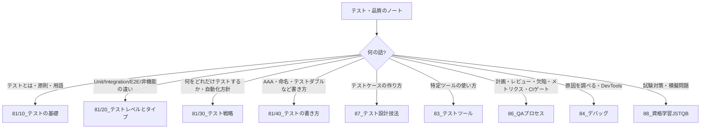

# MOC_テスト体系

81〜88（テスト・品質・デバッグ分野）全体の入口ノート。81 は「何をどれだけテストするか」の考え方、83 はツールの使い方、84 はデバッグ、86 はテストを回すプロセス、87 はテストケースの作り方、88 は JSTQB の試験対策を扱う。

分け方は ISTQB / JSTQB Foundation Level シラバス v4.0 の6章（基礎 / SDLC / 静的テスト / テスト分析と設計 / テストマネジメント / ツール）と、roadmap.sh QA、Testing Trophy を参考にした。

## 分野マップ

| フォルダ | 役割 | 入口 | JSTQB FL の章 |
|---|---|---|---|
| 81_テスト戦略 | テストの基礎・レベルとタイプ・戦略・書き方 | 本MOC | 1・2章、5章の一部（リスク） |
| 83_テストツール | Vitest / Playwright などの使い方 | [[MOC_テストツール]] | 6章 |
| 84_デバッグ | DevTools・失敗の調べ方 | [[MOC_デバッグ]] | — |
| 86_QAプロセス | ライフサイクル・計画・レビュー・欠陥・メトリクス・品質ゲート | [[MOC_QAプロセス]] | 2・3・5章 |
| 87_テスト設計技法 | ブラックボックス・ホワイトボックス・経験ベース・コラボレーションベース | [[MOC_テスト設計技法]] | 4章 |
| 88_資格学習JSTQB | 試験対策（章ノート・模擬問題・用語集） | [[00_JSTQB_FL_目次と受験ガイド]] | 全章 |

### 運用ルール

- 本編（81〜87）は実務の知識、88 は試験対策。88 の章ノートから本編の本拠地へは [[00_JSTQB_FL_目次と受験ガイド]] の対応表でたどる
- 81 のファイル名は各フォルダ内で **読む順に `01_` から連番**（2026-09-25 に旧 12〜14 も振り直し）。86・87 の旧「QAエンジニア教材」の連番（06〜11・15・16）はファイル名に残っているだけで、並び順はこの MOC で示す
- フレームワーク固有のテスト（React Testing Library の使い方など）は 32_React/17_テスト、CI の設定そのものは 62_CI-CD が本拠地。設計の側から見た「テストしやすさ」は 43〜47 の各 `70_品質…` フォルダ

### 新しいノートの置き場所

## 81_テスト戦略

### 00_全体像
- [[目次_旧07_Testing]] — 旧 07_Testing の構想（戦略・種別・技法・ツール・CI・デバッグの6軸）。書く予定だったノートの一覧として残している

### 10_テストの基礎
1. [[01_テストの目的とテストで行う3つのこと]] — 検証・妥当性確認・バグ探索
2. [[02_テストの7原則]]
3. [[03_エラー・欠陥・故障とデバッグ]] — 用語の区別、テストとデバッグ、静的／動的

### 20_テストレベルとタイプ
1. [[01_テストレベル]] — JSTQB の5レベルと Unit / Integration / E2E の対応
2. [[02_テストの種類（機能・非機能）]] — テストタイプ、確認・回帰、スモークなど
3. [[03_非機能テスト概要]]

### 30_テスト戦略
1. [[01_テスト戦略とは]] — 戦略・計画・ケースの違い、アプローチの型、戦略例
2. [[02_テストの形（ピラミッド・Trophy・Honeycomb）]]
3. [[03_テスト自動化の考え方]]
4. [[04_探索的テストとリスクベーステスト]]
5. [[05_カバレッジの読み方]]

### 40_テストの書き方
1. [[01_良い単体テストの条件]] — FIRST 原則、4本の柱
2. [[02_テストの構造（AAA・Given-When-Then）]]
3. [[03_テストの命名と粒度]]
4. [[04_テストダブルの分類]]
5. [[05_テストデータの用意]]

10→40 は「前へ／次に読む」リンクで1本道につながっている。

## 旧「QAエンジニア教材」の所在

| 旧 No. | いまのノート | 置き場所 |
|---|---|---|
| 01 テストレベル | [[01_テストレベル]]（2026-09-25 新規作成） | 81/20 |
| 02 テストツール | [[MOC_テストツール]] に統合 | 83/00 |
| 06〜10 | 同値分割・境界値・デシジョンテーブル・ペアワイズ・状態推移 | 87/10_ブラックボックス |
| 09 テストで行う3つのこと | [[01_テストの目的とテストで行う3つのこと]]（新規作成） | 81/10 |
| 10 テストの種類（機能・非機能） | [[02_テストの種類（機能・非機能）]]（新規作成） | 81/20 |
| 11 | [[11_欠陥管理とバグレポート]] | 86/40_欠陥管理 |
| 12 | [[03_テスト自動化の考え方]] | 81/30 |
| 13 | [[04_探索的テストとリスクベーステスト]] | 81/30 |
| 14 | [[03_非機能テスト概要]] | 81/20 |
| 15 | [[15_テスト計画とドキュメント]] / [[15_開発のライフサイクル]] | 86/20 / 86/10 |
| 16 | [[16_テストメトリクスと品質指標]] / [[16_コードレビューの基礎]] | 86/50 / 86/30 |

Vitest 教材が参照していた「10_テストの考え方」は [[02_テストの形（ピラミッド・Trophy・Honeycomb）]]、「11_単体テストの書き方」は [[01_良い単体テストの条件]] にリンクを付け替えた。
