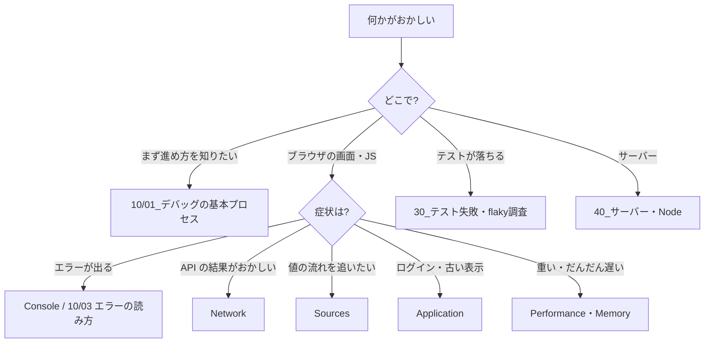

# MOC_デバッグ

故障の原因を見つけて直すためのノートの入口。テスト全体の地図は [[MOC_テスト体系]]。個別の障害事例は 91_トラブルシューティング事例集 に置く。

## フォルダ構成

| フォルダ | 役割 |
|---|---|
| 10_デバッグの考え方 | 道具に依存しない進め方：再現・切り分け・エラーの読み方・ログ |
| 20_ブラウザDevTools | Chrome DevTools の各パネルの使い方 |
| 30_テスト失敗・flaky調査 | テストが落ちた・たまに落ちるときの調べ方 |
| 40_サーバー・Node | Node.js のデバッガ・ログ・本番調査・よくある問題 |

### 本拠地の分担

| テーマ | 本拠地 |
|---|---|
| デバッグの進め方・道具の使い方 | **84_デバッグ（ここ）** |
| 実際に起きた障害の事例 | 91_トラブルシューティング事例集 |
| React DevTools・React 固有のバグ（再レンダリング・メモリリーク） | 32_React（[[2-5-デバッグ]]、21_トラブルシューティング集） |
| テストとデバッグの違い・用語 | 81（[[03_エラー・欠陥・故障とデバッグ]]） |
| 分散システムの可観測性（トレース・メトリクス） | 66_可観測性 |
| Web の性能指標と最適化 | 67_パフォーマンス |

### どこから読むか

## 10_デバッグの考え方
1. [[01_デバッグの基本プロセス]] — 再現 → 事実 → 切り分け → 仮説と検証 → 修正 → 再発防止、メモのテンプレート
2. [[02_原因の切り分け方]] — 二分探索、git bisect、差分、最小再現、レイヤー
3. [[03_エラーメッセージとスタックトレースの読み方]] — エラーの種類、メッセージの読み方、ソースマップ、非同期のスタック
4. [[04_ログを使ったデバッグ]] — 一時ログのテクニック、ログレベル、構造化ログ、出してはいけないもの

## 20_ブラウザDevTools
1. [[DevToolsの開き方と基本]]
2. [[Elements（要素の検査）]]
3. [[Console（コンソール操作）]]
4. [[Network（通信の監視）]]
5. [[デバッグ実践]] — 基本のブレークポイントと実例
6. [[Sources（ブレークポイントとステップ実行）]] — 例外・XHR・DOM・イベントのブレークポイント、Ignore List、Overrides
7. [[Application（ストレージ・Cookie・キャッシュ）]] — Cookie の属性、ストレージ、Service Worker、Clear site data
8. [[Performance・Memory（遅さとメモリリークの調査）]] — Long Task、Bottom-Up、ヒープスナップショットの比較

## 30_テスト失敗・flaky調査
1. [[01_テストが落ちたときの調べ方]] — 誰が悪いかの切り分け、失敗出力の読み方、Vitest / Playwright のデバッグ、CI でだけ落ちるとき
2. [[02_flakyテストの原因と対策]] — 原因の7分類、見つけ方、原因別の直し方、リトライと隔離の運用

## 40_サーバー・Node
1. [[01_Node.jsのデバッガ]] — --inspect、Chrome DevTools、VS Code、TypeScript・Next.js・Docker
2. [[02_サーバーのログと本番の調査]] — pino、リクエスト ID、エラー監視、ログから原因を探すコツ
3. [[03_サーバー側のよくある問題の調べ方]] — 落ちる・返らない・詰まる・メモリリーク・デプロイ先でだけ動かない

10→40 は「前へ／次に読む」リンクでつながっている（20 の既存5本は番号なしのまま、MOC の順で読む）。
